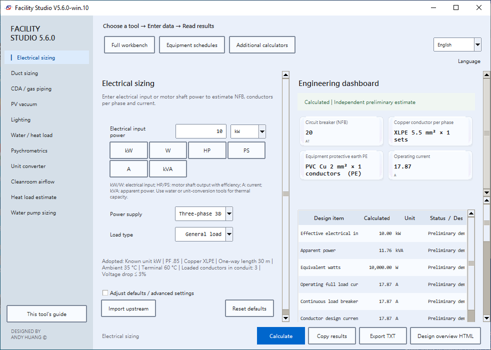
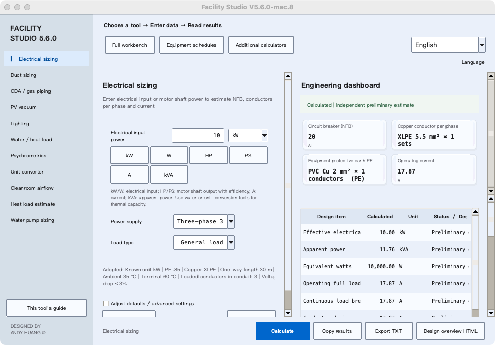

# Facility Studio | Facility engineering estimates and HVAC calculations

[繁體中文](README.md) · [User guides](docs/guides/README.en.md) · [FAQ](docs/faq.en.md) · [Report a problem](https://github.com/azx4121/facility-studio/issues)

**Turn equipment power, airflow, water flow and room conditions into engineering demands you can compare.**

Facility Studio is a desktop tool for facility, electrical and HVAC engineers. Use an independent calculator for a single question, import Excel/CSV schedules for multiple devices, or use the full workbench for HVAC schemes, AHU stages and reports.

**Windows / macOS · Traditional Chinese / English · Offline calculations · No separate Python installation**

## Download and run

Published version: **V5.6.0 public test release**, Windows **win.10** (2026-11-01, look matches macOS; calculations as win.9) / macOS **mac.8** (2026-11-01, same calculation code). Both are prereleases; each published binary passed its native acceptance gates. Previous releases remain available.

This release's water sizing extends to **30 inches**; **all ten calculators are direct sidebar buttons** (including Cleanroom airflow, Heat load estimate and Chilled-water pump); the gas calculator and workbench share **50 factory gases plus custom mixtures**. Added gases with demand require an entered design velocity. Zero-demand workbench rows retain unused drafts without blocking the whole project. The test process includes **100 distinct scenarios, repeated 20 times each**. Explicit engineering rejections are distinguished from software faults. [Engineering review, dimension sources and scope](docs/2026-10-16-gemini-integration-review.md) · [Windows win.8 acceptance and SHA256](docs/2026-10-18-windows-report-audit.md#原生發布結果)

| Platform | Download | Start |
| --- | --- | --- |
| Windows 10/11, Intel/AMD x64 | [**Download Windows EXE**](https://github.com/azx4121/facility-studio/releases/download/v5.6.0-win.10/Facility_Studio_V5_6_0_Windows_Offline.exe) | Save and double-click; allow time for the bundled environment to unpack on first launch |
| macOS, Apple Silicon / Intel | [**Download macOS DMG**](https://github.com/azx4121/facility-studio/releases/download/v5.6.0-mac.8/Facility_Studio_V5_6_0_macOS_mac8.dmg) | Open the DMG, drag Facility Studio into Applications, then launch it there |

Download one file for your platform. Help and equipment templates are bundled. [Versions and SHA256](https://github.com/azx4121/facility-studio/releases) · [Compatibility and first launch](docs/faq.en.md#compatibility)

The Windows EXE has no official publisher signature; the Mac app has no Developer ID or Apple notarization. First launch may show a security prompt. Check the download source and follow the [security-prompt guide](docs/signing.en.md).

## Current revision (win.10 / mac.8)

**win.10 / mac.8 change the look only: the Windows window now matches macOS.** The same window used to show text about one third larger on Windows (Tk converts points differently) and used a different button widget for the workbench navigation; both platforms now use the same text-size mapping and navigation style. **So win.10 text is smaller than win.9** (125 % / 150 % display scaling still scales it up). Calculations and reports are unchanged. Fonts and window frames come from each system, so the two are not pixel-identical. [Comparison and verification](docs/2026-11-01-win10-mac8-ui-unification.md)

Calculation and report fixes since win.9 / mac.7:

Fixes the defect where a supply temperature difference near zero silently produced an absurd airflow (about 7.4×10⁹ CMH, shown only as "data pending"). Three guards (numerical, physical, engineering) now refuse such designs as "Conditions not met" with the cause and the chilled-water limit, **without a fixed ACH cap**; ordinary designs are unchanged (560 recorded cases identical). Quality-gate statuses are unified, chilled-water margins are listed before and after the margin, PV pressure hints match the per-unit ranges, and the U-value unit is shown with the field, in help and in the report. **Windows and macOS now ship the same calculation code.** Release notes: [win.9](docs/releases/v5.6.0-win.9.md) / [mac.7](docs/releases/v5.6.0-mac.7.md); [acceptance record and limits](docs/2026-10-31-win9-mac7-acceptance.md).

Note: air-handler defaults are now bypass stages with no humidifier and 5,000 CMH; state stage settings explicitly in older examples. Verification covers calculation implementation and selection reasonableness; it is **not** proof of FEED, hospital infection-control, GMP or electrical-code compliance.

## Previous revision (win.8 / mac.6)

Windows **win.8** adds visible **PV vacuum** buttons on the homepage and workbench. Reports include adopted conditions, individual equipment power sources, unit ratings and governing equipment counts; duty explanations, fixed units and revision identity are corrected. Unknown pipeline inputs are rejected rather than silently using defaults. [Corrections, report samples and acceptance](docs/2026-10-18-windows-report-audit.md#english). It retains win.7 F01–F07, source restoration and the lighting-count correction. macOS remains mac.6.

This revision includes **ten quick tools**, including Cleanroom airflow, Heat load estimate and Chilled-water pump, plus **explicit catalogue utilization factor U with room-index K checks** in both the Lighting calculator and Full Workbench. It adds explicit MAU/FFU airflow topology and ACH basis, nominal FFU module/coverage checks, separate pump shaft/electrical power, and an upstream-import chain from room airflow through heat load, water, pump and electrical demand. Imported electrical totals use explicit device inputs; chiller cooling is converted only with COP or an entered electrical input. Reports begin with calculated-demand and suggested-selection summaries, with KPI cards and HTML tables.

Existing schema 11 projects migrate to schema 12 while retaining independent FFU circulation, direct MAU room supply and the original gap-orifice leakage method. A plenum path and its ACH basis must be selected explicitly; OA is not automatically added to every historical FFU calculation. Reference leakage ACH, 30 CMH per person in the quick tool and the 85% ceiling allowance are preliminary project assumptions, not universal ASHRAE/ISO requirements.

See the [engineering and dashboard audit](docs/2026-10-16-gemini-integration-review.md), and the detailed sections in the [workbench](docs/guides/workbench.en.md#source-revision), [electrical](docs/guides/electrical.en.md#source-revision), [water/pump](docs/guides/water.en.md#source-revision) and [AHU](docs/guides/ahu.en.md#source-revision) guides.

## What can you use it for?

| Your task | What you get | Tool / example |
| --- | --- | --- |
| Estimate supply requirements for new equipment | Current, circuit-breaker and conductor candidates, preliminary voltage drop | [Electrical sizing](docs/guides/electrical.en.md) |
| Compare round and rectangular ducts for a known airflow | Dimensions and actual velocity; preliminary pressure loss when a route is supplied | [Duct sizing](docs/guides/duct.en.md) |
| Estimate CDA / nitrogen / process-gas piping from flow and pressure | Actual volume flow and reference pipe diameter | [CDA / gas piping](docs/guides/gas-vacuum.en.md) |
| Find process-vacuum flow and preliminary piping | Absolute-pressure conversion, actual pipe flow and reference diameter | Windows win.10 / macOS mac.8 homepage **PV vacuum**, or the full workbench → [PV example](docs/guides/gas-vacuum.en.md#case-07) |
| Check room and thermal requirements | Average lux / lamp count, water flow / capacity, air states and unit conversions | [Lighting](docs/guides/lighting.en.md) / [Water](docs/guides/water.en.md) / [Psychrometrics](docs/guides/psychrometrics.en.md) / [Units](docs/guides/units.en.md) |
| Consolidate an Excel/CSV equipment schedule | Grouped electricity, PCW, CDA, N2, EXHAUST, DI and PV demand | [Equipment schedules](docs/guides/equipment.en.md) |
| Compare HVAC schemes and AHU stage configurations | Summer/winter heat and moisture demand, preheat / precool / humidification / recool / reheat, capacity checks and reports | [Full workbench](docs/guides/workbench.en.md) / [Standalone AHU](docs/guides/ahu.en.md) |

Each quick tool works independently. Adopted conditions and defaults appear on screen and in reports, so you can review the assumptions and compare demand after a change.

| Windows (win.10) | macOS (mac.8) |
| --- | --- |
|  |  |

*Both are the published installer / DMG started on a native desktop (GitHub Actions: Windows Server 2022, macOS 15) and captured as the window opens, uncropped and unretouched, with default inputs. Fonts and window frames come from each system, so the two are not pixel-identical; provenance, hashes and method are in [image provenance](docs/images/README.md).*

## Try one small calculation first

1. Launch the app and choose **English** or **Traditional Chinese** at the top right. The Windows main caption should include `5.6.0-win.10` (macOS: `5.6.0-mac.8`).
2. Select a tool and enter your values and units. Review the displayed assumptions.
3. Click **Calculate**, then copy the result or export TXT. **This tool's guide** opens the relevant instructions and formulas.

Try **10 kW, three-phase 380 V, general load** with the electrical tool's defaults: expect approximately **17.87 A, a 20 AT breaker candidate and 5.5 mm² per phase**. [Complete assumptions and check](docs/guides/electrical.en.md#case-01)

For a project report, open **Full workbench → Beginner tutorial** and follow the [first six walkthrough sections](docs/guides/workbench.en.md). **Open practice copy** directly loads the MAU example with a staged AHU for the next exercise.

## Before using the results

- **Scope:** preliminary engineering estimates, scheme comparison and demand summaries. Complete equipment selection, regulatory review, fault/protection studies, pipe networks and BIM drawings need separate work.
- **Data:** calculations, saved projects and schedule imports are processed locally. User-entered names and notes retain their original language.
- **License:** internal company engineering work, paid engineering projects and delivered calculation reports are permitted. Software resale, paid bundling or paid hosted software services require separate written permission. [Full terms](LICENSE) · [License examples](LICENSE_GUIDE.en.md)

The published files passed native acceptance on Windows Server 2022/2025 x64 and Apple Silicon/Intel macOS 15. Windows 10/11 and macOS 11+ are support/packaging targets; other OS versions, devices and enterprise policies need individual confirmation. [Windows win.8 verification](docs/2026-10-18-windows-report-audit.md#原生發布結果) · [macOS mac.6 verification](docs/2026-10-16-gemini-integration-review.md#原生發布狀態)

## Help and feedback

[Tool and formula guides](docs/guides/README.en.md) · [FAQ](docs/faq.en.md) · [Documentation](docs/README.en.md) · [Development and tests](docs/development.md#english) · [Historical records](docs/history/README.md#english)

Use [GitHub Issues](https://github.com/azx4121/facility-studio/issues) to report a problem. Include app/OS versions, steps, all values and units, and expected/actual results. Use synthetic data and remove client secrets.

**DESIGNED BY ANDY HUANG ©** · Maintainer [azx4121](https://github.com/azx4121) · [Third-party components](THIRD_PARTY_NOTICES.md)

Windows F01–F07 are corrected; historical findings and evidence remain available. Previously corrupted W/kVA source adoptions require removal and reimport from original data; main-only files need manual reconciliation. win.6/win.7 whole-workspace files use ledger v2, which **mac.6 cannot read**. Keep those files in current Windows until the Mac reader is updated. [Recovery steps and verification limits](docs/2026-10-18-windows-audit-six.md#english).
