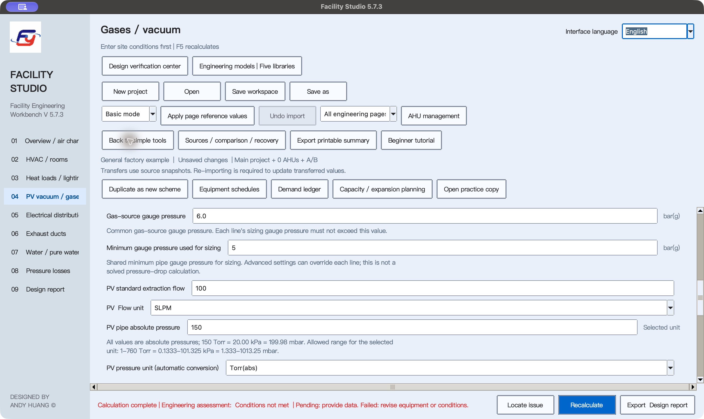

# Facility Studio 5.7.3 | Facility engineering estimates and HVAC calculations

[繁體中文](README.md) · [Visual tour](docs/visual-tour.en.md) · [Getting started](docs/getting-started.en.md) · [Guides](docs/guides/README.en.md) · [FAQ](docs/faq.en.md) · [Documentation](docs/README.en.md)

**Traditional Chinese / English · Offline local calculations · Runtime bundled with packaged builds**

Facility Studio 5.7.3 supports preliminary facility engineering calculations, option comparison and design-demand documentation within its stated model scope. It can assist selected FEED activities. Software verification does not certify a project's FEED deliverables, regulatory compliance or vendor equipment performance. Project-specific design inputs, vendor data, deliverable requirements and professional review remain necessary.

*Actual 5.7.3 v22 r3 macOS ARM64 candidate running natively, **English interface**, uncropped and unretouched. Native launch and selected screens have been checked; the package remains **UNVALIDATED-COMPILE-ONLY**, not fully accepted or FEED-certified. Long English sidebar labels are visibly clipped at this window size.*

[Current workbench and visual tour](docs/visual-tour.en.md#screenshots) · [Artifact identity, original SHA256 and test scope](docs/images/README.md#v573-v22-r3). No verified Git commit mapping is available for this candidate. The images do not establish that repository main is the v22 build source or that a public Release exists.

## Download and run

**Native acceptance and platform publication status are determined by CI records and Release evidence for the exact source commit. A platform download is valid only when its matching Release provides the package and SHA256.** Use the [Releases index](https://github.com/azx4121/facility-studio/releases) to check version, platform, source commit and SHA256. The existence of documentation is not proof of publication or acceptance.

| 5.7.3 delivery target | Package and launch | Acceptance status |
| --- | --- | --- |
| Windows x64; Windows 10/11 support target | Installer and portable ZIP; install into a new empty directory or extract the entire portable folder | Identical packages require Windows Server 2022/2025 native acceptance; consult matching commit CI/Release evidence |
| macOS Apple Silicon ARM64 | ZIP containing Facility Studio 5.7.3.app; extract fully before launch | Consult matching commit CI/Release evidence for ARM64 acceptance; no 5.7.3 Universal, Intel or DMG claim |

Historical prereleases: [Windows win.10](https://github.com/azx4121/facility-studio/releases/tag/v5.6.0-win.10) / [macOS mac.8](https://github.com/azx4121/facility-studio/releases/tag/v5.6.0-mac.8). Their tested hosts and Universal/DMG packages do not establish 5.7.3 acceptance. A formal version name does not establish trusted publisher signing or Apple notarization. See [security prompts](docs/signing.en.md).

## Choose by task

- [Electrical](docs/guides/electrical.en.md): current, breaker and conductor candidates; not short-circuit/protection coordination.
- [Ducts](docs/guides/duct.en.md): dimensions and route pressure loss using entered conditions.
- [Gases and standalone PV vacuum](docs/guides/gas-vacuum.en.md): volume conversion, pipe sizing and pumping-speed necessary conditions, not complete pump selection.
- [Water, liquid/pure-water piping and pumps](docs/guides/water.en.md): verify properties, materials, phase and suction conditions.
- [Lighting](docs/guides/lighting.en.md): catalogue U and IES/LDT direct illuminance; not full reflections or UGR.
- [Psychrometrics](docs/guides/psychrometrics.en.md) and [units](docs/guides/units.en.md): air states, full charts and conversions.
- [Equipment schedules](docs/guides/equipment.en.md): Excel/CSV, DI and PCW supply groups, without merging different supply boundaries.
- [Workbench](docs/guides/workbench.en.md) and [AHU](docs/guides/ahu.en.md): cleanroom, heat loads and seasonal stage demands; required states are distinct from achievable supply.
- [Capacity planning](docs/guides/capacity.en.md) and [design review](docs/guides/design-review.en.md): current/expansion/N−1 screening and document preparation.

There are 12 direct quick tools, including standalone PV and liquid/pure-water piping. Workbench projects, capacity plans and design reviews have separate saving scopes. One successful calculation does not approve the whole project.

## First use

[Six-step visual workflow](docs/visual-tour.en.md#workflow) · [Installation and SHA256 checks](docs/getting-started.en.md)

1. Check the published version, architecture and SHA256. Confirm **Facility Studio 5.7.3** in the application and choose Traditional Chinese or English.
2. Enter one tool's actual inputs and units. Calculate and read adopted assumptions, missing data and failed conditions.
3. Recalculate changed inputs/upstream sources, explicitly reimport downstream values, then save or export. Successful export does not clear engineering warnings.
4. Follow the [workbench walkthrough](docs/guides/workbench.en.md) and [offline tutorial](docs/tutorial/README.md). Historical example numbers are not a fresh 5.7.3 acceptance result.

The formal default data directory is `Facility Studio Data-5.7.3` under the user's home directory. Old release/preview data is not automatically migrated or overwritten. Back up first, import copies and check results; do not overwrite new projects with an older application. See [saving and rollback](docs/faq.en.md#saving).

## Revision and evidence

5.7.3 addresses engineering guards, source invalidation, C2 feasibility and BF/ADP search, necessary vacuum pumping speed, DI continuous-circulation template formula, reports and language consistency. Historical numeric chilled-water remedies are not guarantees; recalculate the complete operating conditions. See the [version changes and release contract](docs/releases/v5.7.3.md) and [formal acceptance evidence schema](docs/verification/5.7.3-release-acceptance.md).

[Image provenance](docs/images/README.md) distinguishes the actual 5.7.3 v22 r3 candidate from historical screenshots. Acceptance results cannot be transferred between them. Complete networks, protection coordination, construction drawings and field acceptance remain outside this tool's delivery.

[Development](docs/development.md) · [Contributing](CONTRIBUTING.md) · [License examples](LICENSE_GUIDE.en.md) · [LICENSE](LICENSE) · [Third-party notices](THIRD_PARTY_NOTICES.md)

Report issues with version, OS/CPU, steps, inputs/units and expected/actual results at [Issues](https://github.com/azx4121/facility-studio/issues). Remove confidential project data.

**DESIGNED BY ANDY HUANG ©**
