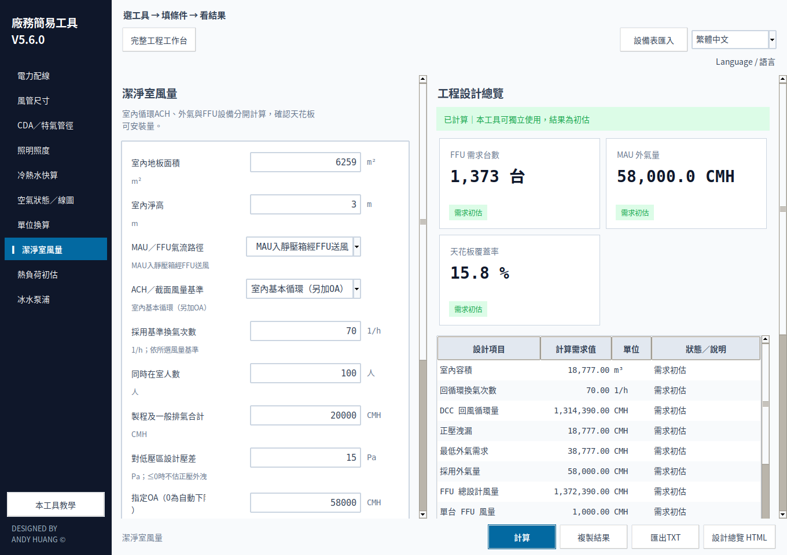

# Facility Studio｜廠務工程初估與空調計算

[English](README.en.md) · [使用指南](docs/guides/README.md) · [常見問題](docs/faq.md) · [問題回報](https://github.com/azx4121/facility-studio/issues)

**把設備功率、風量、水量與空間條件，整理成可比較的工程需求。**

Facility Studio 是供廠務、機電與空調工程人員使用的桌面工具。單項需求可直接快算，多台設備可用 Excel／CSV 彙整，完整工作台則用於空調方案、分段空調箱與報告整理。

**Windows／macOS · 繁體中文／English · 離線運算 · 免另裝 Python**

## 本版修訂重點（win.4／mac.6）

本次來源新增**氣流路徑／ACH 基準、三項工程快算（共十項左側直接快算）、照明型錄 U 與室指數 K 檢核、跨工具帶入、KPI 儀表板、向量 SCADA 與 HTML／TXT 頂部「★ 核心工程設計量與設備選型總覽」**，並修正進階模式顯示互斥 FCU／RCU／MAU 欄位的問題。舊案自動移轉為 schema 12，保留既有獨立循環結果。公式成立條件與驗證界線見[工程審核與修訂說明](docs/2026-10-16-gemini-integration-review.md)；開發者可依[開發文件](docs/development.md)重現來源檢查。

## 下載

目前已發布：**V5.6.0 公開測試版**，Windows **win.3**／macOS **mac.5**。2026-10-16 修正後來源已完成本機測試，**win.4／mac.6 須通過原生驗收後才會發布**（前一版 [win.3](https://github.com/azx4121/facility-studio/releases/tag/v5.6.0-win.3)／[mac.5](https://github.com/azx4121/facility-studio/releases/tag/v5.6.0-mac.5) 仍保留於 Releases）。

本次來源水管自動選型擴充至 **30 吋**；**十個快算直接放在左側**（含潔淨室風量、熱負荷初估、冰水泵浦）；氣體快算與工作台共同提供 **50 種廠務氣體＋自訂／混合氣**。有需求的新增氣體須填設計流速；完整工作台零需求時保留未使用草稿，避免阻擋整案計算。測試流程包含 **100 組不同案例，每組重算 20 次**；工程條件不足會明確拒絕，不等同程式故障。[工程審核與修訂說明](docs/2026-10-16-gemini-integration-review.md) · [功能、尺寸來源與範圍](docs/2026-10-12-v5.6-expansion.md) · [Windows 交付與 SHA256](docs/2026-10-13-v5.6-audit-stress.md) · [Mac 修正與交付](docs/2026-10-13-mac-diagnostics.md)

| 平台 | 下載 | 開始使用 |
| --- | --- | --- |
| Windows 10／11，Intel／AMD x64 | [**下載 Windows EXE**](https://github.com/azx4121/facility-studio/releases/download/v5.6.0-win.3/Facility_Studio_V5_6_0_Windows_Offline.exe) | 儲存後雙擊開啟；首次啟動請等候內建環境展開 |
| macOS，Apple Silicon／Intel | [**下載 macOS DMG**](https://github.com/azx4121/facility-studio/releases/download/v5.6.0-mac.5/Facility_Studio_V5_6_0_macOS_mac5.dmg) | 開啟 DMG，將 Facility Studio 拖到「應用程式」，再從那裡開啟 |

每個平台下載上表的一個檔案即可，教學與設備範本已內建。[版本與 SHA256](https://github.com/azx4121/facility-studio/releases) · [相容性與首次開啟](docs/faq.md#compatibility)

Windows 尚無正式發行者簽章；Mac 尚未取得 Developer ID／Apple 公證。首次開啟可能出現安全提示，請核對下載來源並依[安全提示說明](docs/signing.md)處理。

## 你可以用它解決哪些問題？

| 手上的需求 | 可以得到什麼 | 使用入口／案例 |
| --- | --- | --- |
| 新增設備，先估配電需求 | 電流、NFB 與線徑候選、壓降初估 | [電力配線](docs/guides/electrical.md) |
| 已知排風量，要比較方管／圓管 | 尺寸、實際風速；提供路徑後可初估壓損 | [風管尺寸](docs/guides/duct.md) |
| 已知 CDA／N2／製程氣體流量與壓力，要估管徑 | 實際體積流量與參考管徑 | [CDA／特氣管徑](docs/guides/gas-vacuum.md) |
| 整理空間與冷熱需求 | 平均照度／燈數、水量／熱量、空氣狀態與單位換算 | [照明](docs/guides/lighting.md)／[冷熱水](docs/guides/water.md)／[空氣線圖](docs/guides/psychrometrics.md)／[換算](docs/guides/units.md) |
| 手上已有整批設備 Excel／CSV | 分組彙整電力、PCW、CDA、N2、EXHAUST、DI、PV 需求 | [設備表匯入](docs/guides/equipment.md) |
| 比較空調方案與空調箱各段配置 | 夏冬熱濕需求、預熱／預冷／加濕／再冷／再熱、容量檢核與報告 | [完整工作台](docs/guides/workbench.md)／[單台空調箱](docs/guides/ahu.md) |

各快算工具可獨立使用。採用的條件與預設值會顯示在畫面及報告，方便回頭核對，也方便比較修改前後的需求。

*本次原始碼於 Linux／Tk 的實際畫面；十項快算直接顯示在左側，結果可匯出 TXT／HTML。*

## 第一次使用，從一個小問題開始

1. 開啟軟體，在右上角選擇「繁體中文」或「English」。
2. 選一個工具，輸入手上的數值與單位；先查看畫面列出的採用條件。
3. 按「計算」，閱讀結果後複製或匯出 TXT。需要公式或操作說明時，按「本工具教學」。

可以先試 **10 kW、三相 380 V、一般設備**：沿用電力工具預設條件，應得到約 **17.87 A、NFB 20 AT、每相 5.5 mm² 候選**。[完整條件與驗算](docs/guides/electrical.md#case-01)

要做整案報告，開啟「完整工程工作台」→「新手教學」，依[前六步跟做教學](docs/guides/workbench.md)完成第一份練習報告。「開啟練習新案」則直接載入含分段空調箱的 MAU 範例，適合接著練習。

## 使用前先知道

- **用途：**工程初估、方案比較與需求整理。正式設備選型、法規覆核、短路／保護協調、完整管網及 BIM 出圖需另外完成。
- **資料：**計算、專案保存與設備表匯入在本機完成；自己的設備名稱與備註保留原文。
- **授權：**允許公司內部工程工作、收費工程案件及計算書交付；軟體轉售、付費綁售或付費線上軟體服務需另行書面授權。[完整條款](LICENSE) · [授權案例](LICENSE_GUIDE.md)

目前發布檔已通過 Windows Server 2022／2025 x64，以及 Apple Silicon／Intel macOS 15 原生驗收。Windows 10／11 與 macOS 11+ 為支援／封裝目標，其他版本、實機與企業政策仍需個別確認。[Windows 驗證](docs/2026-10-13-v5.6-audit-stress.md) · [Mac mac.5 驗證](docs/2026-10-13-mac-diagnostics.md)

## 文件與問題回報

[工具與公式指南](docs/guides/README.md) · [常見問題](docs/faq.md) · [文件中心](docs/README.md) · [開發與測試](docs/development.md) · [歷史紀錄](docs/history/README.md)

發現問題請到 [GitHub Issues](https://github.com/azx4121/facility-studio/issues)，附上軟體／作業系統版本、操作步驟、輸入值與單位，以及預期／實際結果。請使用測試資料並移除業主機密。

**DESIGNED BY ANDY HUANG ©** · 維護者 [azx4121](https://github.com/azx4121) · [第三方元件](THIRD_PARTY_NOTICES.md)
