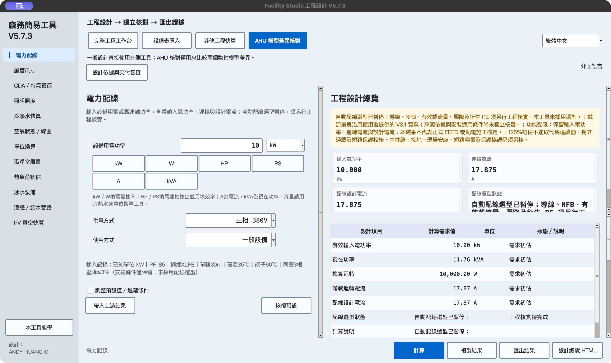

# Facility Studio 5.7.3｜廠務工程初估與空調計算

[English](README.en.md) · [圖解導覽](docs/visual-tour.md) · [安裝與起步](docs/getting-started.md) · [工具指南](docs/guides/README.md) · [常見問題](docs/faq.md) · [文件中心](docs/README.md)

**繁體中文／English · 本機離線計算 · 成品內含 Python 執行環境**

Facility Studio 5.7.3 是廠務工程初估、方案比較與設計需求整理工具，可支援 FEED 階段中符合已列模型範圍的部分計算與文件準備。軟體測試驗證計算及操作實作，不代表專案已通過 FEED、法規或原廠設備性能認證。設計條件、原廠同工況資料、交付範圍及專業覆核仍須由專案團隊完成。

*實際執行的 5.7.3 v22 r3 macOS ARM64 候選包，繁中介面；原圖未裁切或改圖。已完成原生啟動及部分畫面檢視，仍為 **UNVALIDATED-COMPILE-ONLY**，不是全功能驗收或正式 FEED 核定。圖中自動配線選型已暫停。*

[新版工作台及圖解導覽](docs/visual-tour.md#screenshots) · [成品身份、原圖 SHA256 與測試範圍](docs/images/README.md#v573-v22-r3)。此候選包尚未建立可核對的 Git commit 對應；圖片不代表本倉庫 main 即為 v22 來源，也不代表已公開 Release。

## 下載

**此版本的原生驗收與各平台發布狀態，以對應 commit 的 CI 紀錄及 Release 附件為準；只有對應 Release 已提供平台成品及 SHA256 時，該平台下載才有效。** 請到 [Releases 版本總頁](https://github.com/azx4121/facility-studio/releases)核對實際公開版本、平台、來源 commit 與 SHA256；文件存在本身不表示成品已發布或驗收通過。

| 5.7.3 交付目標 | 格式與使用方式 | 驗收狀態 |
| --- | --- | --- |
| Windows x64，Windows 10／11 為支援目標 | 安裝版與 portable ZIP；安裝至新的空目錄，portable 須完整解壓 | 同一包須在 Windows Server 2022／2025 原生驗收；結果見對應 commit CI／Release 附件 |
| macOS Apple Silicon ARM64 | ZIP 內的 Facility Studio 5.7.3.app，完整解壓後開啟 | ARM64 原生驗收結果見對應 commit CI／Release 附件；本版不是 Universal／Intel／DMG |

歷史公開測試版：[Windows win.10](https://github.com/azx4121/facility-studio/releases/tag/v5.6.0-win.10)／[macOS mac.8](https://github.com/azx4121/facility-studio/releases/tag/v5.6.0-mac.8)。舊版測試主機、DMG 與 Universal 支援不能轉作 5.7.3 證據。正式版名稱不表示已具備商用簽章或 Apple 公證，見[安全提示](docs/signing.md)。

## 依問題選入口

| 需求 | 入口與範圍 |
| --- | --- |
| 電流、NFB、線徑候選與壓降初估 | [電力配線](docs/guides/electrical.md)，不含短路／保護協調 |
| 風管尺寸及路徑壓損 | [風管](docs/guides/duct.md)，需實際路徑及阻力 |
| CDA、特氣與獨立 PV 真空 | [氣體與真空](docs/guides/gas-vacuum.md)，抽速必要條件不等於完整泵選型 |
| 冷熱水、液體／純水管路、泵浦 | [水路](docs/guides/water.md)，核對物性、材料、相態與吸入條件 |
| 照度、IES／LDT 直接光配置 | [照明](docs/guides/lighting.md)，非完整反射／UGR 模型 |
| 空氣狀態、完整線圖與單位換算 | [空氣線圖](docs/guides/psychrometrics.md)／[單位](docs/guides/units.md) |
| 設備 Excel／CSV、PCW 分群及 DI | [設備表](docs/guides/equipment.md)，不同供應邊界不合併 |
| 潔淨室、熱負荷、工作台與分段 AHU | [跟做教學](docs/guides/workbench.md)／[AHU](docs/guides/ahu.md)，需求點與可供應能力分開 |
| 現況／擴充／N−1 初篩及交付文件 | [容量](docs/guides/capacity.md)／[設計依據與交付審查](docs/guides/design-review.md) |

左側有 12 項直接快算，包含獨立 PV 真空與液體／純水入口；完整工作台、容量規劃、設計審查各有其保存範圍。不要將一個計算成功視為整案通過。

## 第一次使用

[圖解六步流程](docs/visual-tour.md#workflow) · [逐步安裝及 SHA256 核對](docs/getting-started.md)

1. 先核對下載版本、平台與 SHA256，開啟後確認名稱為 **Facility Studio 5.7.3**；在介面選繁體中文或 English。
2. 選單一工具，填實際工況與單位，按計算並閱讀採用條件、待資料與未達條件。
3. 修改輸入或上游來源後重算，明確重新帶入下游，再保存／匯出。匯出成功不會清除工程警告。
4. 完整工作台可從[新手跟做](docs/guides/workbench.md)與[離線教學](docs/tutorial/README.md)開始；歷史案例數字不代表本版已重驗。

正式預設資料目錄為使用者家目錄下的 `Facility Studio Data-5.7.3`，不自動覆寫或搬移舊版／preview 資料。升級前備份，匯入副本並核對結果；勿以較舊版本直接覆寫新版專案。[保存與回退](docs/faq.md#saving)

## 修訂、限制與證據

5.7.3 整理工程護鎖、來源失效、C2 可行性與 BF／ADP 搜尋、真空抽速必要條件、DI 持續循環量範本公式、報告與語系一致性。舊版「降低冰水至某數值即可修復」的建議不能當保證；須用完整工況重算。詳細範圍見[版本變更與發布契約](docs/releases/v5.7.3.md)與[正式驗收證據格式](docs/verification/5.7.3-release-acceptance.md)。

[圖片來源](docs/images/README.md)分別記錄 5.7.3 v22 r3 真實候選畫面與歷史版本，不互相轉用驗收結果。正式選型、完整管網、保護協調、施工圖與現場驗收仍須另外完成。

[開發與測試](docs/development.md) · [參與維護](CONTRIBUTING.md) · [授權案例](LICENSE_GUIDE.md) · [LICENSE](LICENSE) · [第三方元件](THIRD_PARTY_NOTICES.md)

問題請到 [Issues](https://github.com/azx4121/facility-studio/issues)，附版本、主機／CPU、步驟、輸入與單位、預期及實際結果；移除業主機密。

**DESIGNED BY ANDY HUANG ©**
