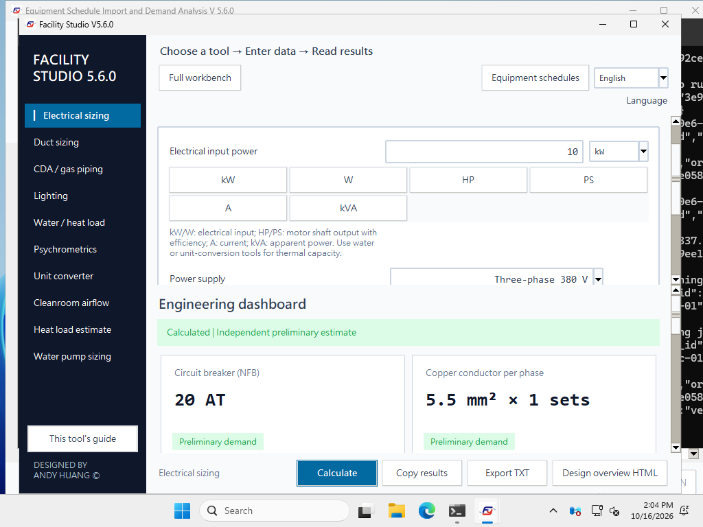
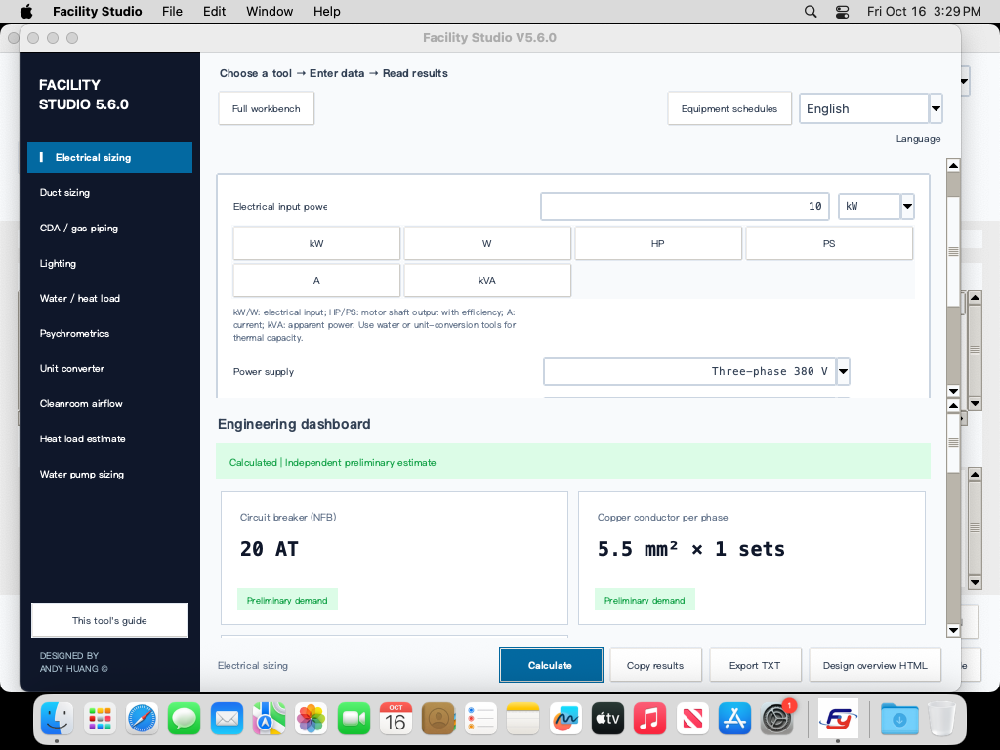

# Gemini 修正版整合覆核 · 2026-10-16

本頁保留 2026-10-16 win.4／mac.6 的整合與發布紀錄；目前 Windows 結果見 [win.7 工程稽核與驗收](2026-10-18-windows-audit-six.md)，照明修正的原始 win.5 證據見 [F07 驗收](2026-10-18-windows-lighting-f07.md)。
基於 GitHub `b9251d3`，與提供的完整 `facility-studio-v5.6.0-win4-mac6-fixed.zip` 及逐份附件比對。保留 V5.6.0；Windows 修訂 win.4、macOS 修訂 mac.6。計算資料 schema 12，舊 schema 11 保留原獨立 FFU 循環語意。

## 已確認並修正

| 問題 | 重現結果與修正 |
| --- | --- |
| 上游電功率單位 | 10 kW 泵浦帶入既有 W 表單只算成 0.01 kW；帶入時現在明確設定 kW，重複帶入不累加。 |
| 馬達與電氣輸入混用 | 合併保留最新 main 的 HP／PS 與馬達效率；kW／W 一律為電氣輸入，HP／PS 為軸輸出，A／kVA 另依相數、電壓、PF 換算。 |
| 冷量當成設備用電 | 電力表單移除 kcal/h、RT、BTU/h；冰機只經 COP 或明填輸入 kW 併入用電。固定供電換算與冷熱功率分類分開。 |
| 照明自動 U | `K/(K+0.59)` 無燈具配光依據，不能宣稱 DIALux 校準；現在 U 依型錄／反射率手填，K 使用實際長寬與燈高，只協助查表。未提供長寬會提示欄位。 |
| MAU 入口冷量 | 同一乾空氣質量流率換算室內／外氣入口 CMH，不應縮放 kW；報告現在列入口實際 CMH，保留原冷量。 |
| 冰機總容量 | 需求明列為各溫度迴路最大負荷的容量包絡；與 MCHW／CHW／DCCW 各迴路選型及裕度一致，不能視為同時尖峰或共同主管。 |
| 零面積 FFU | 原本會除以零；現在回傳可定位的 `en_L_A` 輸入錯誤。 |
| 不使用的 COP 草稿 | 明填冰機輸入 kW 時，停用 COP 不再阻擋帶入。 |
| Mac 導覽／捲動／退出 | 保留原生 ttk 選取樣式、捲動邊界與觸控板步數，修正 `unknown option -bg`；恢復快算主視窗的 Quit 文件保護掛接與 Command-Return，選取文字對比提高到4.5:1以上。 |
| 小視窗與連續操作 | 工具列依實際寬度換行，主視窗長狀態文字跟隨可用寬度；重設回到頂部。快算只重排可見頁，重用未變KPI與捲動範圍，避免不必要的連續重繪。Mac 另省略未變更文字、選項與報告的重設，重選相同語言不再次通知全部視窗；未使用分頁不保留在原生顯示階層；隱藏／非總覽的空氣線圖延後繪製，相同座標／氣壓／季節／語系重用圖表，修正輸入後清除待重算標記；回到總覽或匯出 PNG 時使用最新季節與結果；工具列也以頂層實際可用寬度限制按鈕，避免父容器暫時超寬。數字鍵盤測試依新捲動容器揭示目標，仍檢查真實焦點與小數事件。 |
| 啟動副作用 | 移除啟動時刪除／覆寫已安裝舊版來源的快取同步；缺少 Tk 時也不再使用會自動答「是」的假 UI。 |
| 打包內容 | 重新 stage 與逐檔雜湊，移除依賴已安裝 Python 的 C# 啟動器冒充離線單檔的 fallback；離線批次檔改用實際 PyInstaller 建置。 |
| 測試改寫交付檔 | 舊 V5.5 回歸會重寫 `Default_Project.json`，Windows 文字換行導致來源與封裝不同。現在只輸出到 evidence，另核對交付範本與 schema，完整性標準不放寬。 |
| 安裝包完整性測試 | 原候選測試只抽出歷史 62 個成員，再靠 bootstrap 內嵌碼補檔。現在對當前所有成員逐一比對並完整解出，缺件直接失敗。 |
| 首頁與連結 | 原 README 提前指向不存在的 win.4／mac.6；發布前保留有效的 win.3／mac.5 下載，原生流程發布後已切換至win.4／mac.6。截圖與平台／版本標示一起更新。 |

保留十項直接快算、三種氣流情境、上游失效保護、FFU 發熱、KPI、向量 SCADA、七項設備總覽、雙語 TXT／HTML、50 種氣體及自訂混合氣。新增 26／28／30 吋 STD 內徑依供應商表格確認；14–30 吋參考壁厚 9.5 mm，實供仍需核對。

## 本次實測

本機：Linux x86_64／CPython 3.12.14，分開載入 Windows 與 macOS 來源；原始碼測試與原生 EXE／App 驗收分列。

| 測試 | 每個來源的結果 |
| --- | --- |
| 獨立 100 組電力／照明／泵浦／連動／MAU 公式驗算 | 4,432 項檢查通過 |
| 全欄位、停用值、雙語 TXT／HTML 與 100 次隨機情境 | 6,977 項檢查通過 |
| 工程新邊界 | 68 項通過 |
| 設備總覽及 HTML／語系 | 72 項通過 |
| 真實 Tk 儀表板與帶入失效 | 314項通過；含欄位顯示、Enter、匯出、錯誤恢復及正常／懸停文字對比、最小視窗工具列及捲動後焦點 |
| Mac 電力單位與介面回歸 | 14 項測試通過，包含重複語系更新保留草稿／選取、父容器暫時超寬時的按鈕邊界；Windows 原對應 12 項亦通過 |
| 真實 Tk 互動語系 | 連續 UI 序列的語系子集：Windows 32 項、Mac 35 項通過，無背景回呼錯誤 |
| 原生流程相同順序的來源UI檢查 | Windows 182 項、Mac 187 項通過；語系、教學、縮小、轉入、草稿防護與鍵盤事件連續執行。此列仍是Linux來源測試。 |
| 既有核心／快算／V5.5～5.6／安全／語系回歸 | 通過，保留測試命令與紀錄 |
| 100 種潔淨室，每組重算 20 次 | 100／100 軟體行為正確，18,451 項檢查通過；89 組可計算，11 組正確拒絕不成立條件 |
| 教學 20 情境及使用案例 | 通過，參考報告與內建教學同步更新 |
| 發布器／下載資產保護 | 31 項通過 |
| 線上 Setup 重新封裝 | CRC、完整解壓及逐檔一致性驗證；不等於 Windows 安裝執行驗收 |

壓測採固定 seed `20261016`。舊壓測的獨立 FFU 參考式未涵蓋 schema 12 的 OA 經 FFU 路徑，已擴充獨立參考計算；兩份凍結清單的 100 組物理輸入雜湊逐一相同。沒有刪除失敗條件或放寬守恆門檻。過去 evidence 保留原版本，本次證據另存本日資料夾。

[本次測試證據](evidence/2026-10-16-gemini-review/) · [重現命令](development.md)

GitHub 流程先後攔截 `q_total_basis` 完整報告必要欄位遺漏、Windows 回歸測試改寫交付範本，Mac Quit／導覽文字對比，以及小視窗工具列／捲動焦點與Intel連續操作延遲。各項均修正後重跑相應防護與原生驗收；未通過原生驗收的平台交付檔未發布。Intel 候選先後觸及單次 5 秒及整輪 300 秒上限；Mac 專屬修正減少同值語系通知與隱藏圖表繪製，再重新建置完整交付檔；另新增實際 draw-event、季節切換及隱藏 PNG 匯出的回歸檢查。沒有延長上述限制。

## 原生發布狀態

2026-10-16 原生發布完成。受測提交：Windows `cd2fe8330aee584f948e152b4962c1a02d0c0ed3`；Mac `4eabd9ce7cb6c275f588309ab0faf39ef0ea9b91`。Windows 發布後的 Mac 專屬介面修正不更動 Windows 程式；後續首頁與證據整理亦不改動受測程式。每平台均以同一份交付檔完成第二環境驗收，才新增 Release。

| 交付／檢查 | 原生／來源環境與結果 | 執行紀錄 |
| --- | --- | --- |
| Windows win.4 | Windows Server 2022 建置與離線執行；Windows Server 2025 重驗相同 EXE／ZIP；通過 | [Windows Actions](https://github.com/azx4121/facility-studio/actions/runs/38910619703) |
| macOS mac.6 | Apple Silicon／Intel macOS 15；相同 ZIP／DMG 的簽章、掛載與 GUI 執行；通過 | [Mac Actions](https://github.com/azx4121/facility-studio/actions/runs/38922689461) |
| win.4 受測來源檢查 | Linux／Python3.13，數值、報告、回歸與真實 Tk 檢查；通過 | [Source Actions](https://github.com/azx4121/facility-studio/actions/runs/38910619930) |
| 目前兩平台來源檢查 | Linux／Python3.13，Windows 與 macOS 來源的數值、報告、回歸與真實 Tk 檢查；通過 | [Source Actions](https://github.com/azx4121/facility-studio/actions/runs/38922689468) |

公開下載已重新讀取並核對位元組、SHA256及GitHub資產身分；每平台公開程式與對應`SHA256SUMS.txt`。完整ZIP保留為原生驗收產物，既有win.3／mac.5檔案與tag保留。

| 程式檔 | 大小（bytes） | SHA256 |
| --- | ---: | --- |
| [Facility_Studio_V5_6_0_Windows_Offline.exe](https://github.com/azx4121/facility-studio/releases/download/v5.6.0-win.4/Facility_Studio_V5_6_0_Windows_Offline.exe) | 41,038,610 | `49a04498b8353f4ef1f0d202de48576af925502dff202c232d2356b02a48a802` |
| [Facility_Studio_V5_6_0_macOS_mac6.dmg](https://github.com/azx4121/facility-studio/releases/download/v5.6.0-mac.6/Facility_Studio_V5_6_0_macOS_mac6.dmg) | 146,283,098 | `fb5d4cf53856dcb22d735c5f67be6aebd86a4b03e1d70218720ebee1bbc4f4d7` |

[本次原生與下載證據](evidence/2026-10-16-gemini-review/native-release-verification.json) · [所有版本](https://github.com/azx4121/facility-studio/releases)

原生環境為上述Server版本及macOS15；Windows10／11與macOS11+是支援／封裝目標。實體鍵盤、使用者DPI、企業政策及其他系統版本仍需個別確認。線上Setup的CRC／完整解壓檢查與本次離線EXE原生驗收分開記錄。

逐項原生證據：[Windows Server 2022](evidence/2026-10-16-gemini-review/native/windows-2022/summary.json) · [Windows Server 2025](evidence/2026-10-16-gemini-review/native/windows-2025/summary.json) · [Apple Silicon](evidence/2026-10-16-gemini-review/native/macos-arm64/summary.json) · [Intel Mac](evidence/2026-10-16-gemini-review/native/macos-intel/summary.json)。Windows 各三條交付路徑每次 248 項；Mac 建置端四條、Intel 端兩條路徑每次 241 項，均通過。完整介面檢查與耗時保留於相鄰 JSON。

*Windows Server 2025 的實際 win.4 驗收畫面，使用合成資料。*

*Apple Silicon macOS 15 的實際 mac.6 驗收畫面，使用合成資料。[圖片來源與 SHA256](images/README.md)。*

## 公式與範圍依據

- [DIAL 官方流明法說明](https://evo.support-en.dial.de/support/solutions/articles/9000078303-lumen-method-)：U 需結合反射率及燈具光度資料查表，幾何 K 不是唯一決定因素。
- [美國能源部泵浦指南](https://www.energy.gov/sites/default/files/2014/05/f16/pump.pdf)：清水水功率、軸功率及輸入電力依效率分開。
- [台灣供應商遠東鋼管尺寸表](https://www.snyi.com.tw/product-femco01.html)：核對 STD 外徑／壁厚至 30 吋；參考內徑不代表所有實供管材。

工程條件不足、FFU 配置超限、DCC 空氣側不足及標準馬達／斷路器超表，仍必須保留提示。通過軟體測試不會把不成立的工程條件改成可採購規格。

## English

Reviewed against main `b9251d3` and the supplied Gemini archive. Corrected upstream kW/W interpretation, restored HP/PS efficiency behavior, separated thermal capacity from electrical demand, removed unsupported DIALux U(K) claims, preserved cooling kW across volumetric-reference conversions, matched chiller capacity envelopes to separate temperature loops, repaired zero-area validation and native Mac navigation, and rebuilt installer staging without self-healing code or installed-Python launcher fallbacks.

Both source trees passed independent formulas, exhaustive field/report checks, real Tk workflows and 100 physical cleanrooms repeated 20 times. Eleven deliberately incompatible cases were correctly rejected. Frozen physical recipes were preserved while the independent reference model was updated for explicit schema-12 airflow topology. Local Linux source evidence is separate from native EXE/App acceptance. New public downloads are linked only after their native publication gates succeed.

Native Windows Server 2022/2025 gates passed for `cd2fe8330aee584f948e152b4962c1a02d0c0ed3`; Apple Silicon/Intel macOS 15 gates passed for `4eabd9ce7cb6c275f588309ab0faf39ef0ea9b91`. The Mac-only follow-up preserves the Windows source tree. The exact public EXE/DMG and checksum downloads were independently hashed after publication; see the native delivery table above. Historical released assets were retained.
