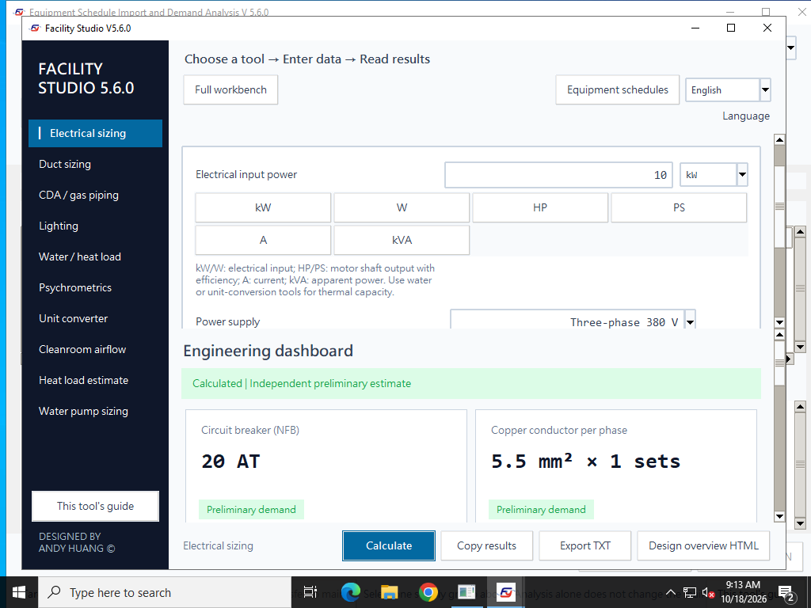

# Windows win.7：工程稽核、來源復原與交付驗收

[首頁](../README.md) · [English](#english) · [win.7 Release](releases/v5.6.0-win.7.md) · [win.5 照明歷史紀錄](2026-10-18-windows-lighting-f07.md)

本次僅修改 Windows。win.6 修正 F01–F06；其原生驗收通過並發布後，再測出手動值／單位與再次帶入的復原缺陷，另發 win.7 修正，不覆寫 win.6。win.5 的 F07 照明修正持續保留。macOS mac.6 的應用程式來源與已發布檔案不變。

## 修正與獨立驗算

| 項目 | 優先度 | 重現與修正後行為 |
| --- | --- | --- |
| F01 水管報告 | P2 | 引擎原已採用實填 ΣK，但報告可能顯示 0；TXT／HTML 改列實際 ΣK，核對 `Δp局部=ΣK×ρ×v²/2`，不重複加壓損。 |
| F02 電力摘要 | P1 | 摘要原另選 125% AT，與本迴路的線徑／保護候選不一致；改採同一個 NFB、導線、組數及有效載流量。主進線列尚未計算。 |
| F03 功率來源 | P1 | W／kVA 等原有基數改用物理一致的有效功率；同 ID 替換、逐盤保存 PF／效率換算條件。舊錯存資料明確標示需重建。 |
| F04 末端容量 | P1 | RCU／FCU 改用夏冬較大 C1＋C2 冷量乘餘裕選台數；FCU 另取風量需求較大者。報告列採用季節與基準。 |
| F05 泵浦單位 | P2 | LPM、m³/h、US GPM 切換保持實際水量、軸功率、馬達輸入電力與銘牌候選。 |
| F06 數值換算 | P3 | 避免可表示結果的中間運算溢位；超出有限值明確報錯、清除舊結果；絕對零度邊界正確處理。 |
| F03 復原補正（win.7） | P1 | 200 kW 手改後移除來源不再變成 200 kVA；移除或來源更新釋出欄位時清除舊復原記錄，下次採用記住當次原值，包含零基數與存檔重開。 |
| F07 照明（保留 win.5） | P1 | 不因按室指數檢核而改採隱藏長寬；75 m²、500 Lux、4,000 lm、U=0.6、M=0.8 保持 20 盞，不變成 8 盞。 |

照明的 20→8 盞是可重現的缺陷示例；實際比較軟體名稱、兩邊完整輸入與原廠配光條件尚未全部取得，不能認定它是使用者現場六成差異的唯一原因。

數值基準採獨立公式與固定輸入，不把修正函式的輸出當成唯一預期值：

- **電力：**10 kW、三相 380 V、PF 0.85 一般負載，`I=10000/(√3×380×0.85)=17.8746 A`。預設敷設下同迴路候選為 20 AT、5.5 mm²、有效載流 25 A；200 kW 一般負載為 400 AT，不再因另一個摘要級距表而列無候選。
- **來源：**100 kVA、PF 0.85＋10 kW＝95 kW；100 W＋10 kW＝10.1 kW。HP 按軸功率／效率，A 按線電壓與 PF。UP／NP 可以在不同 PF 設定下首次帶入，各保留自己的換算基準。
- **RCU：**合成冬季日射 100 kW、ACH 100、無人員、預冷旁通案例，夏季盤管約 58.9477 kW、冬季約 131.8975 kW；乘 1.1 得約 145.0872 kW。30 USRT／台需 2 台，舊夏季單獨基準會少選為 1 台。這是測試輸入，不是現場設計。
- **泵浦：**100 LPM＝6 m³/h≈26.4172 US GPM，揚程 20 m、泵效率 0.7、馬達效率 0.9 時，輸入約 0.519048 kW，銘牌候選 0.75 kW，切換單位不改變結果。
- **換算：**1e308°F 的所有目標仍可表示，應接受；1e308°C 轉 °F 溢位，應拒絕。−459.67°F＝0 K 應接受，低於絕對零度拒絕。

移除後仍由其他來源控制的欄位會重新彙整，不套用已釋出欄位的復原規則。手改數值／單位的保留指原始草稿，不保證在另外修改 PF 等工程條件後物理功率不變。[同輸入修正前後記錄](evidence/2026-10-18-audit-six/restoration-cases.json)

win.7 另驗證手改數值、只改單位、兩者皆改，以及水／氣體／排氣不同欄位命名；來源更新失去電力欄位與直接移除都釋出舊記錄。真實介面覆蓋多次帶入／移除、保存／重開、取消不變更，以及 win.6 空彙整殘留非零基數。

## 舊資料與跨平台使用

1. 先備份整案，核對原始設備 W／kVA 與來源表。
2. 若新版顯示「舊版電力帶入需重建」，移除本盤已納入的電力來源。未手改的欄位回復原始數值／單位；手改的數值／單位成組保留，須自行確認。
3. 用原始資料重新帶入，確認預覽、其他設備基數與本盤有效功率，再儲存。不要把舊錯存 kW 留作新的基數。

僅有主案 JSON、沒有需求彙整來源歷史時，無法可靠判定某個 kW 是否由舊 W／kVA 錯換而來，程式不猜改，需要人工比對原始資料。上述重建也不替代原廠 PF、效率與設備設計條件。

Windows win.6／win.7 的需求彙整為 **ledger v2**，逐盤保存換算基準；可讀舊 v1。主案 schema 仍為 12，但整案的 ledger 是另一層版本。以 mac.6 來源實測，新 v2 整案會因「需求彙整格式不符」拒絕，**不能宣稱新整案可由 mac.6 開啟**。請先在目前 Windows 使用，待 Mac 讀取器更新後再同步；不要刪除來源、AHU 或方案資料來強迫舊版讀取。[格式實測](evidence/2026-10-18-audit-six/format-compatibility.json)

中英文電力指南同步更正：kW／W 是電氣輸入，效率只用於 HP／PS 軸輸出；若已將軸功率除效率換成輸入 kW，不再除第二次。移除「另列 125% 摘要斷路器」的過期說明。

## 驗證範圍

win.7 獨立數值／邊界 **2,182 項**，中英文真實 Tk 來源操作 **140 項**，合計 **2,322 項**。F07 另有 2,500 數值與 71 來源操作。目前指南的 18 個適用案例與 2 個範圍對照另取本次 Windows 原生主機上的來源測試輸出，[案例記錄](evidence/2026-10-18-audit-six/windows-use-cases.json)不冒充封裝 EXE 測試。既有工程、單位、停用欄位、資料韌性、報告、雙語、資安、安裝器及封裝回歸持續執行。線上 Setup 成套重建並完整解出 86 成員，逐一核對 82 個應用 payload 檔案；這不代替離線 EXE 原生執行。

來源 CI 另執行獨立 Gemini 公式覆核、100 次全欄位／報告突變及 100 組潔淨室每組 20 次。封裝 EXE 本身也執行 100 組不同物理條件、每組 20 次的計算／保存／報告壓力測試。不同啟動路徑重跑同一組案例，不冒稱是新增獨立設計案例。

win.6 首次擴充驗收曾在單程序 210 秒被攔截（[失敗流程](https://github.com/azx4121/facility-studio/actions/runs/39092056793)），該候選未發布。後改為核心與延伸兩個獨立 EXE 程序，各保留 210 秒上限與五秒心跳；逾時終止該測試的整棵程序樹後清理，沒有放寬原預算。win.6 修訂後的[原生流程](https://github.com/azx4121/facility-studio/actions/runs/39092885569)通過並發布；後續發現的復原問題在 win.7 另修，不修改歷史 EXE。

### 畫面驗收觀察

win.5／win.6，以及本次 win.7（Server 2022／2025）的驗收末尾 `Windows_Electrical.png` 有表單／結果區空白，較早語系驗收的 `English_Electrical.png` 則內容完整。這是雲端 Windows 結尾擷取／重繪的觀察，不能僅憑功能斷言視為完整視覺驗收，也尚不能認定一般使用者每次開啟都有此缺陷。首頁採用內容完整的原生英文畫面，保留其來源與雜湊，不修圖補內容。實體 Windows 10／11 的縮放、最小化／還原與遠端桌面重繪仍需現場重驗。這項觀察保持未結案：[結尾空白擷取原圖（Server 2022）](images/v560-win7-capture-observation.png) · [兩套主機觀察記錄](evidence/2026-10-18-audit-six/capture-observations.json)。

## 原生發布結果

**Windows win.7 已通過兩套原生環境驗收並發布。** [原生發布流程](https://github.com/azx4121/facility-studio/actions/runs/39114093849) · [Windows 中英文來源操作](https://github.com/azx4121/facility-studio/actions/runs/39114093859) · [跨平台來源回歸](https://github.com/azx4121/facility-studio/actions/runs/39114093855)。

受測提交 `400a8ee88ff18dbfb7b16b759e61a35533c249f3`，Windows 應用來源 tree `3ad9fef9417170592008a72b2206ac0f22a8e81b`。文件後續提交保留這份已測 Windows tree；macOS tree `9343a70db1da7e9d3127bf8749826a0ac62cd671` 不變。

| 主機 | 啟動方式 | 核心檢查 | 延伸入口／介面 | 獨立數值 | CLI 工具 | 結果 |
| --- | --- | ---: | ---: | ---: | ---: | --- |
| Windows Server 2022 | standalone | 318 | 140 | 2,182 | 10 | 通過 |
| Windows Server 2022 | unicode-executable-path | 318 | 140 | 2,182 | 10 | 通過 |
| Windows Server 2022 | zip-extracted | 318 | 140 | 2,182 | 10 | 通過 |
| Windows Server 2025 | standalone | 318 | 140 | 2,182 | 10 | 通過 |
| Windows Server 2025 | unicode-executable-path | 318 | 140 | 2,182 | 10 | 通過 |
| Windows Server 2025 | zip-extracted | 318 | 140 | 2,182 | 10 | 通過 |

每個路徑合計 458 個頂層檢查，其中 318 核心包含 70 個 F07 操作；延伸另執行 2,182 個數值斷言。EXE 無外部 Python、空白工作目錄、socket 阻擋；獨立檔／ZIP 另有 Windows 對外防火牆規則，中文路徑以 socket 稽核阻擋。每次的 100 組 × 20 次計算／保存／報告壓力檢查亦通過。

| 公開下載檔 | Bytes | SHA256 |
| --- | ---: | --- |
| [Windows win.7 EXE](https://github.com/azx4121/facility-studio/releases/download/v5.6.0-win.7/Facility_Studio_V5_6_0_Windows_Offline.exe) | 41,079,379 | `f9e3b30fb3f3feb581212822e13cebb9e115ca3893d818f876159c4db3a8e4b9` |

公開 EXE 與 SHA256SUMS.txt 均重新下載，大小與 GitHub digest 相符，公開校驗檔僅列該 EXE 且與兩套原生證據一致。win.6／win.5／win.4／mac.6 的 tag、Release ID、資產 ID、大小與 digest 保持原值。

資料：[發布與公開下載核對](evidence/2026-10-18-audit-six/native-release-verification.json) · [Windows 2022 全部核心／延伸操作](evidence/2026-10-18-audit-six/windows-2022/summary.json) · [Windows 2025](evidence/2026-10-18-audit-six/windows-2025/summary.json) · [2,182 個數值斷言](evidence/2026-10-18-audit-six/numeric-assertions.json) · [來源預檢](evidence/2026-10-18-audit-six/source-local.json) · [原生圖片身分](evidence/2026-10-18-audit-six/screenshot-identity.json)。原始 Artifact ZIP 按 API 大小與 SHA256 核對後安全解壓；原始報告雜湊一併保存。

*Windows Server 2022 實際 win.7 EXE，合成 10 kW 資料，未修改原圖。畫面完整性與結尾擷取觀察見前節。Windows 10／11 為支援目標，未宣稱已完成實體電腦人工驗收。*

## English

Windows win.7 retains F01–F06 from win.6 and lighting F07 from win.5, and fixes restoration discovered after win.6 passed publication gates. Edited values and units remain paired on source removal; released fields capture fresh originals on re-adoption, including zero baselines and saved workspaces. Historical releases and macOS mac.6 remain unchanged.

The summary now uses the same circuit breaker/conductor candidate, water reports show actual K, power adoption preserves physical W/kVA and per-panel conversion bases, terminal cooling uses the peak season, pump units retain physical flow, and unrepresentable conversions fail clearly. Acceptance includes 2,182 independent numeric checks and 140 real-widget source checks; delivered EXE acceptance is recorded above separately.

The 20-to-8 lighting example reproduces a defect; it does not establish the sole cause of a field comparison without the other software and complete inputs.

Legacy corrupt W/kVA adoptions require backup, removal and reimport from original data. Main-only projects without source history need manual reconciliation. Ledger v2 whole workspaces cannot be opened by mac.6 even though the main schema remains 12. Keep them in current Windows until its Mac reader is updated. kW/W mean electrical input; efficiency applies to HP/PS shaft output only.

Native hosts are Windows Server 2022/2025. Windows 10/11 are support targets, without a claim of physical-device testing. Cloud end-of-suite captures have shown a blank client area while earlier English captures are complete; functional tests do not establish comprehensive visual acceptance. Physical-window repaint, DPI and enterprise environment checks remain separate.
