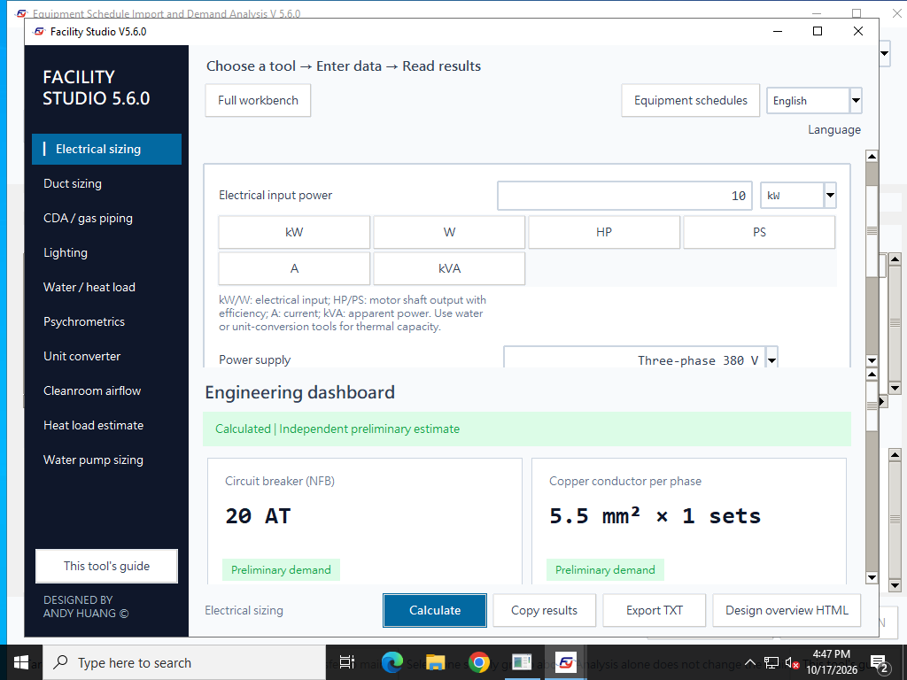

# Windows win.5：照明 F07 修正與驗收

## 問題與修正

win.4 照明頁的「型錄 U／室指數檢核」會在暫停欄位事件時強制切到長×寬，繞過正常的面積等值換算。輸入 75 m²、500 Lux、4,000 lm／盞、U = 0.6、M = 0.8，原本應為 20 盞；隱藏的預設 6 × 5 m 被採用後卻變成 8 盞，少 60%。

win.5 保留面積模式、計算模式、流明來源與原有數值。使用 m²、坪或體積時，按鈕展開進階條件並提示先輸入實際長寬，原計算維持有效。已選長×寬時只啟用室指數檢核，不替換 LED 估算值或型錄流明。高度條件無效時仍清除結果並顯示錯誤。

只知道面積無法確定室形。手動選長×寬時，原有面積等值換算僅供輸入銜接，長寬仍必須以實際房間尺寸確認，才可用於 K 與原廠 U 表。

| 案例 | 設計面積 | 正確盞數 | 按鈕應採行為 |
| --- | ---: | ---: | --- |
| 75 m² | 75 m² | 20 | 保留面積；提示補實際長寬 |
| 22.6875 坪 | 75 m² | 20 | 保留坪數；提示補實際長寬 |
| 225 m³、淨高 3 m | 75 m² | 20 | 保留體積／淨高；提示補實際長寬 |
| 實際 15 × 5 m | 75 m² | 20 | 保留尺寸；啟用 K 檢核 |

```text
N = ceil(E × A / (Φ × U × M))
  = ceil(500 × 75 / (4000 × 0.6 × 0.8)) = 20 盞
E = 20 × 4000 × 0.6 × 0.8 / 75 = 512 Lux
```

## 驗收方式

`windows/tests/lighting_presets.py --gui` 包含 2,500 項 Decimal 獨立公式核對，以及 71 項真實 Tk 介面檢查，涵蓋兩種語言、四條空間輸入路徑、重複按鈕、隱藏無效草稿、LED 流明來源、估算模式、報告與無效高度。

```bash
python windows/tests/lighting_presets.py --gui
```

同一組實際按鈕檢查納入 `winrelease.selftest`，因此離線 EXE 的兩套 Windows 原生驗收也會執行，並檢查程式確實由內建執行環境載入。發布仍須等兩個 Windows 原生驗收作業全部通過。本次來源、封裝與兩個 Windows 環境的實際結果登錄如下。

本機 Linux／Tk 已通過 2,571 項；安裝來源、NSIS CRC、完整解壓、內嵌檔案比對及雙語／匯入／保存檢查通過。本機來源測試不代表已完成 Windows EXE 驗收。

## 範圍

本次僅修正 Windows 照明 F07。先前 Windows 稽核的 F01–F06 仍待另行修正；macOS mac.6 尚未套用本次變更。使用者原本比較軟體、兩邊輸入與差異方向尚未取得，不能認定本缺陷是其實際案例的唯一原因。

核心流明法不變；U/M、燈具流明、工作面與配光資料仍須對齊。未載入 IES/LDT，不宣稱重現 DIALux 的照度分布、均勻度或眩光模擬。

## 尚待修正項目

下表延續先前 Windows 稽核，這些項目未列入 win.5 修正。重現與測試留在 [Windows 深度稽核](https://github.com/azx4121/facility-studio/actions/runs/39047611894)及 [稽核腳本](https://github.com/azx4121/facility-studio/blob/2fa5c1fdfc75bad7346eb44935a4457481f1f243/audit/windows_deep_audit.py)。

| 編號 | 優先度 | 問題 |
| --- | --- | --- |
| F03 | P1 | 電力需求彙整既有 W／kVA 可能被當成 A 換算，導致總需求錯誤 |
| F02 | P1 | 獨立電力快算的報表 MCCB 與選型 NFB 額定電流可能不一致，保護層級未明確建模 |
| F04 | P1 | RCU 台數僅採夏季需求，冬季需求較大時可能容量不足 |
| F05 | P2 | 泵浦流量單位切換未等值換算，原數字被當成新單位 |
| F01 | P2 | 水管報告 ΣK 可能列為 0；引擎已採用實際 K，但報告未帶入 |
| F06 | P3 | 極大但有限的換算輸入，經中間運算溢位後可能輸出 infinity |

F07 已修正的範圍是照明輸入切換；上述各項的修正與驗收需另行完成。這些記錄不表示所有其他情境均無缺陷。

## English

Windows win.5 fixes F07: the catalogue-U/room-index button previously replaced the current area with hidden dimensions, which could change 75 m² / 20 fixtures into 30 m² / 8 fixtures. It now preserves area, calculation mode and lumen source. For area/volume inputs it asks for actual length and width before enabling K. The 2,500 independent formula checks and 71 real-widget source checks pass on both native Windows environments; frozen EXE acceptance is recorded separately below. Other audit findings F01–F06 remain open, and macOS remains mac.6.

## 原生發布結果

**Windows win.5 已通過兩個原生環境驗收並發布。** [Windows 發布流程](https://github.com/azx4121/facility-studio/actions/runs/39050546260) · [來源照明檢查](https://github.com/azx4121/facility-studio/actions/runs/39050546069) · [完整來源回歸](https://github.com/azx4121/facility-studio/actions/runs/39050545990)。

受測與發布來源提交：`c34a12782f7c70fa79b9b7d395971a1070ee6492`；Windows 子樹：`0613acfa8c3b50b77167bc19d4e51cd714f16912`。後續首頁與證據文件更新保留此 Windows 原始碼子樹。

| 環境 | 啟動路徑 | 封裝檢查 | 其中 F07 | CLI 工具 | 結果 |
| --- | --- | ---: | ---: | ---: | --- |
| windows-2022 | standalone | 318 | 70 | 10 | 通過 |
| windows-2022 | unicode-executable-path | 318 | 70 | 10 | 通過 |
| windows-2022 | zip-extracted | 318 | 70 | 10 | 通過 |
| windows-2025 | standalone | 318 | 70 | 10 | 通過 |
| windows-2025 | unicode-executable-path | 318 | 70 | 10 | 通過 |
| windows-2025 | zip-extracted | 318 | 70 | 10 | 通過 |

每次執行均確認為 `frozen` 的 win.5，無外部 Python、空白工作目錄並阻擋 socket 連線；直接 EXE／ZIP 路徑另加 Windows 對外防火牆規則，中文路徑使用 socket 稽核阻擋。每次內建 100 組不同物理條件、每組 20 次的計算／報告／保存穩定性檢查也通過。這些是同一組案例在不同啟動環境的重驗，不代表新增 600 組獨立設計案例。

公開下載已重新透過 HTTPS 取得並核對位元組數、SHA256、GitHub 資產 digest 與 SHA256SUMS.txt。

| 公開交付檔 | 位元組數 | SHA256 |
| --- | ---: | --- |
| [Windows EXE](https://github.com/azx4121/facility-studio/releases/download/v5.6.0-win.5/Facility_Studio_V5_6_0_Windows_Offline.exe) | 41,044,893 | `0b308ba4195ffd50a7c6f3341fa7ad72b07b60ae3ea67bc5e443a256f3b3e65f` |

資料：[交付與公開下載核對](evidence/2026-10-18-lighting-f07/native-release-verification.json) · [Windows 2022 完整 F07 檢查](evidence/2026-10-18-lighting-f07/windows-2022/summary.json) · [Windows 2025 完整 F07 檢查](evidence/2026-10-18-lighting-f07/windows-2025/summary.json)。原始 ZIP 證據已按 API 大小與 SHA256 驗證，再解壓讀取；Artifact 雜湊與工作流程識別一併留存。



*Windows Server 2022 的實際 win.5 驗收畫面，顯示預設電力工具，使用合成資料；圖片直接取自已驗證的原生測試證據。照明 F07 的各項操作結果見上方 JSON 記錄。*

English: Both native Windows environments passed all three launch paths with the identical delivered EXE. Each path passed 318 checks, including 70 F07 real-widget checks and ten CLI tools, plus the existing 100-scenario/20-repeat software-stability suite. Fresh public download SHA256 and byte counts match the tested binary. The open findings above remain outside this correction.
