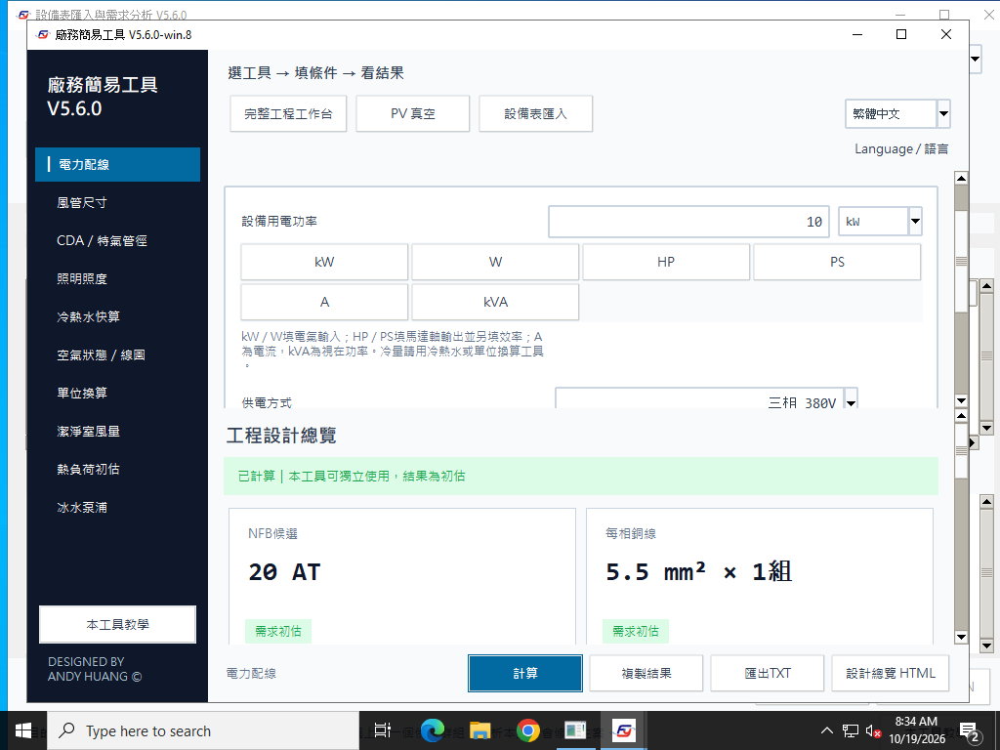

# Windows win.8：報告反推、PV 入口與修正驗證

[首頁](../README.md) · [English](#english) · [win.8 Release](releases/v5.6.0-win.8.md) · [win.7 歷史驗收](2026-10-18-windows-audit-six.md)

本輪將「報告能否還原設計條件與選型理由」納入驗收，並修正 PV 入口不易找到的問題。測試皆使用合成資料；2026-10-18 開始報告修正，2026-10-19 加入 PV 檢查。封裝結果依下節實際記錄。

| 編號 | 修正後行為 | 可以重新核對的依據 |
| --- | --- | --- |
| R01 輸入默默採預設 | 串接服務遇到未知工具／欄位、重複 water／pipes 或錯誤資料型態會明確拒絕。 | 原錯拼 `water.length_m=50` 得 `unknown_field`，不再接受後採 30 m。正確 `water.length=50` 採 50 m，路徑壓差 24,197.929838 Pa，連動泵浦水頭 2.467502 m。正常桌面管長欄位採用正確的 length，本項針對串接 API 的拼字防呆。 |
| R02 電流文字倍率 | 獨立電力快算：一般負載按 1.0 倍；連續／馬達及 HP／PS 按 1.25 倍，報告列出實際算式。 | 10 kW、380 V、PF .85 的一般負載：17.874621 A×1＝17.874621 A；連續負載：×1.25＝22.343277 A。候選分別 20 AT、25 AT。 |
| R03 設計依據不完整 | 簡易 HTML 與串接 TXT／HTML 列採用條件；串接報告分列設備用電與冰機 COP／明填電力依據；工作台列單台冷量／風量及主導台數。 | MAU 2 kW＋製程 20 kW，與 MAU 12 kW＋製程 10 kW，雖合計相同，現在輸出不同來源明細。RCU 30／40 RT／台不再輸出同文 TXT。FCU 16 台可由每台 1,200 CMH、10 RT 與風量／冷量比較重算。 |
| R04 輸入缺單位 | 共同欄位定義保存固定單位，畫面及 TXT／HTML 共用。面積／體積單位隨模式切換。 | 單程 30 m、端子 60°C、壓降上限 3%、粗糙度 0.045 mm、燈具 40 W；PF／U／M 保持無因次。 |
| R05 缺修訂識別 | 主視窗標題標示 `5.6.0-win.8`，各類 TXT／HTML 標示 `5.6.0 · Windows win.8`。封裝版本與報告使用共同修訂常數，PE 資源為 5.6.0.8。 | 十個快算、串接、四種工作台系統、分段 MAU 及七種設備清單的報告皆有修訂識別。 |
| PV 入口隱藏 | 首頁與工作台均有「PV 真空」按鈕，自動展開特氣與真空頁並捲到 PV 欄位，不修改原案數值。 | 原因是預設空調範圍隱藏廠務分頁；PV 也使用獨立絕壓欄位，不在正壓氣體選單。中英文、最小視窗、Torr／kPa／mbar 等值換算及流量一致性共 14 項操作驗證。 |

## 原生發布結果

2026-10-19 已發布 [Windows win.8 公開測試版](https://github.com/azx4121/facility-studio/releases/tag/v5.6.0-win.8)。受測提交：`c121cd872af8f52e3ef8963d138b54b2e7fa8333`；Windows 應用 tree：`6269dd85af0462b0ec4bf8b665b2dd88c413ab38`。原生流程 [39222780789](https://github.com/azx4121/facility-studio/actions/runs/39222780789) 的 build、verify、publish 全數通過。

| 主機 | 獨立 EXE | ZIP 解壓 | 中文空格路徑 |
| --- | --- | --- | --- |
| Windows Server 2022 x64 | 通過 | 通過 | 通過 |
| Windows Server 2025 x64 | 通過 | 通過 | 通過 |

每個路徑均通過 **321 核心、142 延伸入口／介面、2,182 工程數值、405 報告語意、28 匯出／PV 操作，以及十個 CLI 工具**。這是同一批案例在不同主機與啟動路徑的重驗，不將重複執行算成不同設計案例。每次核心驗收含 100 組不同合成輸入、每組重算 20 次；軟體通過不代表所有合成工況都完成原廠資料或容量合格。六次延伸驗收的 UTF-8 mode 均為 0、預設編碼均為 CP1252；沒有回呼或執行錯誤。

電力／空氣最終畫面在六個啟動情境均各取得兩張連續可見取樣，約 0.50～0.53 秒完成；另人工查看兩個主機的三張最終電力頁、英文電力頁與空氣頁，共十張原生截圖。十個 CLI 工具在兩個主機的 JSON 與 TXT 輸出逐份一致。

公開 EXE 為 **41,123,955 bytes**，SHA256：

```text
c91509784295e5c0a42a2148cec6a2aa12108e47203113e7c86eb37eb24d3d56
```

已實際下載 GitHub 交付 artifact、核對全檔 SHA256、ZIP 內 EXE 同一性及 PE32+／AMD64／Windows GUI 資源；FileVersion `5.6.0.8`、ProductVersion `5.6.0-win.8`。公開 Release 的伺服器 SHA256 與位元組數亦完全一致；公開 checksum 的伺服器 digest 符合上列雜湊與檔名的 109-byte 內容。此項是公開資產 metadata 與受測實檔的核對，沒有宣稱第二次從公開下載 URL 重新下載 EXE。

[逐項報告索引](evidence/2026-10-18-report-audit/test-report-index.md) · [原生摘要與全部路徑](evidence/2026-10-18-report-audit/native-summary.json) · [交付檔檢查](evidence/2026-10-18-report-audit/distribution-verification.json) · [公開資產核對](evidence/2026-10-18-report-audit/public-release.json) · [下載 EXE](https://github.com/azx4121/facility-studio/releases/download/v5.6.0-win.8/Facility_Studio_V5_6_0_Windows_Offline.exe)

standalone／ZIP 路徑驗證作業系統出站防火牆與 Python 網路審核封鎖；中文路徑只宣稱已驗證的網路審核封鎖與 Unicode 啟動，`firewall_outbound_blocked=false` 原樣保留。所有路徑均移除外部 Python，使用空白工作目錄。



*Server 2022 的受測 EXE 原始擷取，PV 真空按鈕位於頂部；主視窗標題含 `5.6.0-win.8`。圖片未裁切、重畫或修改。[圖片來源與 SHA256](images/README.md)*

## 已完成的來源與實際匯出檢查

| 主機／範圍 | 結果 |
| --- | --- |
| Windows Server 2022 的 Windows 來源 | F01–F06：2,182 數值＋140 介面；R01–R05：405 語意＋28 真實匯出／PV 操作，全部通過。F07 的 2,500 數值＋71 操作另通過。 |
| Windows Server 2025 的 Windows 來源 | 同上；不是新增的互不重複設計案例。 |
| Linux 上的 Windows 來源 | 全欄位／報告 100 次、6,977 檢查；獨立工程覆核 4,432；報告檢查 75；工程邊界 68；儀表板 Tk 操作 314；雙語重跑 4,968；新增報告／PV 405＋28，均通過。 |
| 線上 Setup 成套重建 | 84 個應用 payload、88 個內含成員完整解出；20 項封裝及 22 項安裝器完整性檢查通過。這不是線上安裝流程的實機驗收。 |

兩套 Windows 來源流程：[39222780790](https://github.com/azx4121/facility-studio/actions/runs/39222780790)，受測提交 `c121cd872af8f52e3ef8963d138b54b2e7fa8333`，與公開 EXE 受測來源相同。兩個來源主機均以 `utf8_mode=0`、預設 `cp1252` 通過，來源與封裝 EXE 證據分別記錄。Linux 全欄位等廣泛檢查保留本輪 PV 加入前的通過證據；報告／PV、雙語與安裝包完整性已針對本次發布來源重跑。Mac 應用來源沒有更動。

新增檢查會從報告中解析電流算式及 HTML 表格，確認實際倍率、採用 50 m、設備來源、單台額定、固定單位與修訂。它不只比對兩種報告是否輸出相同數字。刻意輸入未知欄位而被拒絕，是預期的工程輸入檢查，不是軟體故障。

[全部測試報告索引](evidence/2026-10-18-report-audit/test-report-index.md) · [來源檢查明細](evidence/2026-10-18-report-audit/source-local.json) · [兩套 Windows 來源證據](evidence/2026-10-18-report-audit/native-source-summary.json) · [修正後重現數據](evidence/2026-10-18-report-audit/post-fix-cases.json) · [Windows CP1252 405＋28 檢查](evidence/2026-10-18-report-audit/report-regressions-source.json)

## 報告是否足以理解設計意圖

報告現在可用來核對「採用條件→計算需求→單台基準→向上選級」，並保留用電來源的分配。例：預設 FCU 風量需求 18,435.670161 CMH，每台 1,200 CMH，需 15.363059 台；冷量含餘裕 85.732946 kW，每台 10 US RT，需約 2.438 台。風量主導，取 16 台。RCU 則直接列出當次單台額定冷量，避免同為 1 台時看不出選型假設。

PV 另做 [11 項流量／補風交叉驗算](evidence/2026-10-18-report-audit/pv-flow-crosschecks.json)：2,000 SLPM、150 Torr 為約 10,133.333 ALPM；75 Torr 的管內體積流量加倍，同一標準抽氣需求的室內補償不變。相同室內／標準溫壓、室內抽取比例 1，對應 120 CMH；關閉人員與漏風等條件可單獨重現這個量。預設 20 人×24 CMH／人主導時，比例 1／0 的最低外氣均為 480 CMH，說明「某一輸入改變但總量未變」可能來自最大條件控制。這 11 項是 Windows 計算來源在 Linux 的獨立覆核，與兩套原生 UI 驗證分開計數。

TXT／HTML 仍是審閱報告；重新開啟專案、保留停用草稿及完整來源／方案資料須保存整案 JSON。只有計算結果而沒附輸入的舊式呼叫會標示缺少採用條件，不用預設值補造。報告不替代原廠同工況選型與現場設計資料。

本輪附 24 份可閱讀的中英文範例：[目錄與 SHA256](evidence/2026-10-18-report-audit/reports/index.csv)。這些是 Linux 上的 Windows 來源輸出，與封裝 EXE 的原生報告分開標示。例：[一般負載](evidence/2026-10-18-report-audit/reports/electrical-general-zh-Hant.txt) · [管長 50 m 與用電來源 A](evidence/2026-10-18-report-audit/reports/pipeline-A-zh-Hant.html) · [相同總量、不同來源 B](evidence/2026-10-18-report-audit/reports/pipeline-B-zh-Hant.html) · [FCU 台數依據](evidence/2026-10-18-report-audit/reports/FCU-zh-Hant.txt)

## 畫面觀察與範圍

先前 win.7 的驗收末尾畫面中央空白、較早英文畫面完整。win.8 候選 `a332f98` 的嚴格像素檢查同樣失敗，未發布。移除背景清除旗標的試驗未解決問題，已恢復原旗標。後續驗收加入限時連續畫面觀測；驗收保留暫存 TkAgg 清理前畫面，再檢查清理、最小化還原及工具切換後的電力／空氣表單映射、像素內容與黑塊比例；須在約三秒內取得兩張連續可見畫面（含最後擷取最多 3.5 秒），保留所有嘗試的原圖與時間。第一筆清理前觀察可為空白，不作最終合格判定；合格要求還原後及切換後各有兩張連續可見畫面。原始圖片不裁切或重畫；實際結果依上節記錄。這不構成對單一根因或所有 Windows 顯示環境的保證。

`0c82d44` 已通過 standalone 的 321 核心檢查，電力／空氣各取得兩張連續可見畫面，取樣耗時分別約 0.55／0.50 秒；後續延伸驗收發現報告檢測器有一處未指定 UTF-8，在凍結版的 CP1252 預設環境解碼失敗。這是檢測器讀檔瑕疵，報告本身原已按 UTF-8 寫入。已補明編碼，來源 CI 關閉 UTF-8 mode 重跑，原生記錄另列實際預設編碼。[文字 I/O 覆核](evidence/2026-10-18-report-audit/locale-io-review.json)。

未發布候選的失敗結果亦保留：[畫面調查記錄](evidence/2026-10-18-report-audit/render-investigation.json)。調整旗標的試驗沒有解決問題，未將該試驗當作已證實修正。

人工檢視還看到一項非阻擋文字潤飾：英文導線候選顯示「1 sets」，單複數可改為「1 set」。並聯組數與線徑數值正確；此項先列作後續文字整理，圖片保留實際原文，不以修圖掩蓋。

Windows 10／11 實體電腦的 DPI、遠端桌面及企業政策仍須另驗。Mac 維持 mac.6；Windows ledger v2 整案仍不能由 mac.6 開啟。舊版已錯存的 W／kVA 來源仍依前輪說明從原始資料重新帶入。

## English

win.8 rejects unknown pipeline inputs, prints the actual quick-tool circuit-duty multiplier, exports adopted conditions and individual equipment power sources, shows terminal ratings/governing counts, includes fixed units, and identifies the Windows revision in reports. Direct PV vacuum buttons expose the hidden utility page without changing saved inputs. New acceptance decodes report arithmetic and HTML tables: 405 semantic checks plus 28 actual export/PV checks, run on both Windows source hosts and required inside the delivered EXE. Published win.8 passed all six native launch combinations on Server 2022/2025. Each runs 321 core, 142 extended, 2,182 numeric, 405 semantic and 28 export/PV checks plus ten CLI tools. Public asset digests match the downloaded, native-tested binary. Native publication and image evidence are recorded above separately; source checks do not certify a frozen executable.

The online Setup payload was rebuilt and structurally verified against current sources; this does not claim a physical online-installation test. mac.6 and historical releases remain available. Whole-workspace ledger v2 files still require current Windows. Saved JSON is needed to reopen complete projects; reports explain adopted design conditions without preserving every inactive draft or scheme.
