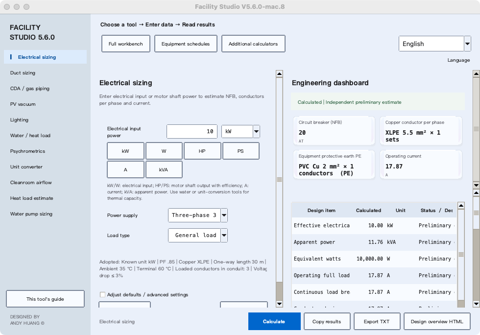

# Facility Studio visual tour

[繁體中文](visual-tour.md) · [Home](../README.en.md) · [Getting started](getting-started.en.md) · [Tool index](guides/README.en.md)

These three diagrams were prepared on 2026-11-08 against the 5.7.3 documentation and source commit `01e0a3239e1dc962e76d8c23a91a2f623eaebe95`. They illustrate workflows and model boundaries, not actual UI screens. They do not establish acceptance of another candidate, native package or FEED deliverable. Check the [matching Release](https://github.com/azx4121/facility-studio/releases) for actual platform publication and evidence.

## 1. Choose a workspace for your question

- **One calculation:** choose electrical, ducts, gases/PV, water, lighting, air states or units.
- **An entire room/project:** use the full workbench for climate, rooms, loads, airflow paths and project reports.
- **Equipment and expansion:** compare seasonal staged-AHU demands and screen current, expansion and N−1 capacity cases.
- **Document preparation:** use design review to record sources, adopted conditions and missing evidence; professional review remains necessary.

The workspaces have separate saving scopes. Saving a full workbench project does not save an independent capacity plan or design review. See [saving](faq.en.md#saving).

## 2. Complete your first report

Start with the [first synthetic practice project](guides/workbench.en.md#first-case). Read missing-data and failed-condition warnings after calculating. Do not invent inputs just to clear a warning. Explicitly reimport changed upstream values into downstream tools and review their adopted assumptions again.

Project JSON is for reopening work; TXT/HTML/PDF is for reading. Full calculation-result JSON and direct-lighting result JSON are not reopenable full-project files. Follow the [six-step workbench guide](guides/workbench.en.md#start).

## 3. An AHU target point is not proof of available capacity

This is a staged-AHU treatment concept, not a mandatory configuration or a complete FFU/DCC return-air network. Each stage receives the preceding outlet. Bypass unused stages. Check seasonal flow bases, heat/moisture balances, installed capacities and vendor data at the same operating conditions.

Surplus H2 capacity cannot directly offset insufficient H1 capacity. Colder chilled water or a BF/ADP airflow search does not guarantee feasibility. See the [AHU guide](guides/ahu.en.md).

## 4. Actual interface: historical native screenshot

The image below is the actual **V5.6.0 mac.8** native application, unchanged and retaining its version title. It is not a 5.7.3 screenshot. Source: [GitHub Actions 41278438651](https://github.com/azx4121/facility-studio/actions/runs/41278438651). Host, capture method and SHA256 are documented in the [image provenance](images/README.md).

The [Windows win.10 original](images/v560-win10-native-en.png) also retains its historical identity. Neither establishes publication, current platform parity or acceptance of new features.

[Image and diagram provenance](images/README.md) · [Acceptance evidence schema](verification/5.7.3-release-acceptance.md)

**DESIGNED BY ANDY HUANG ©**
