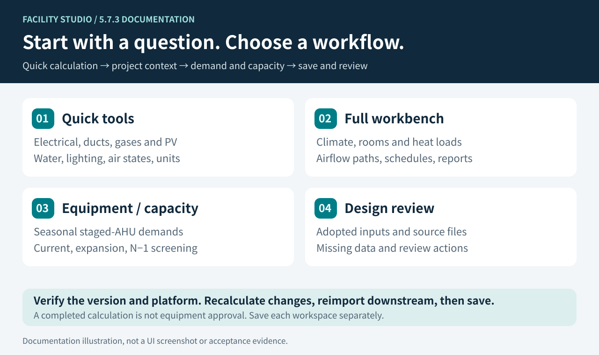
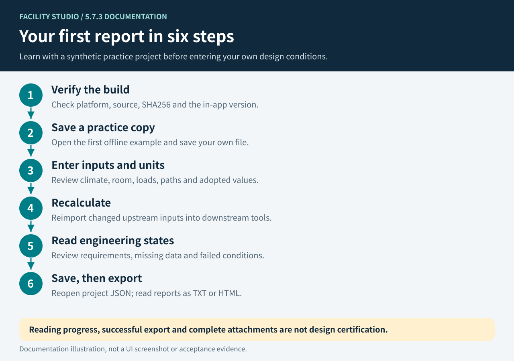
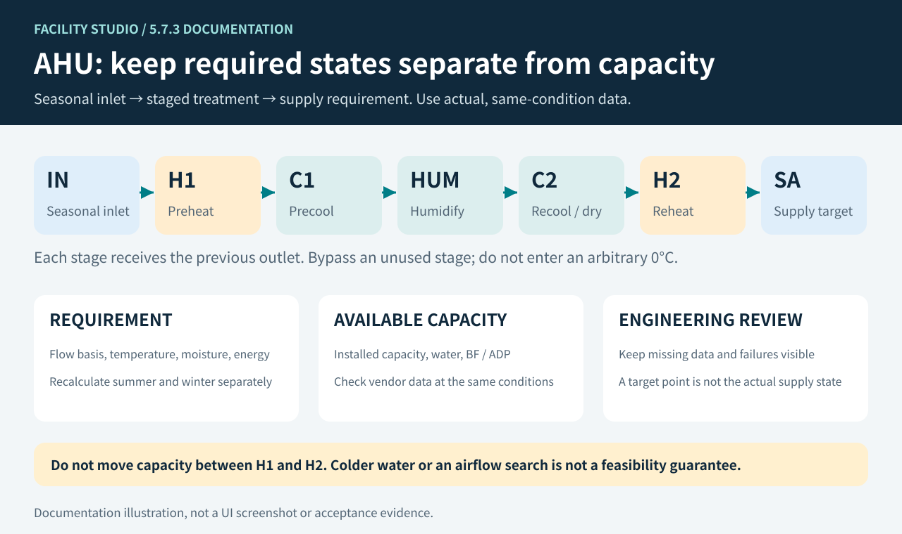
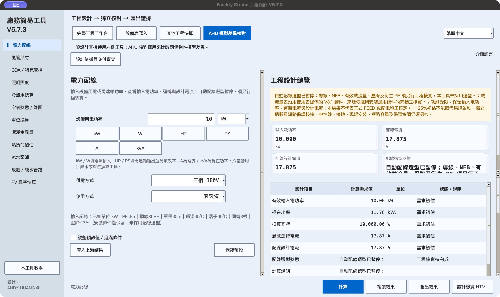
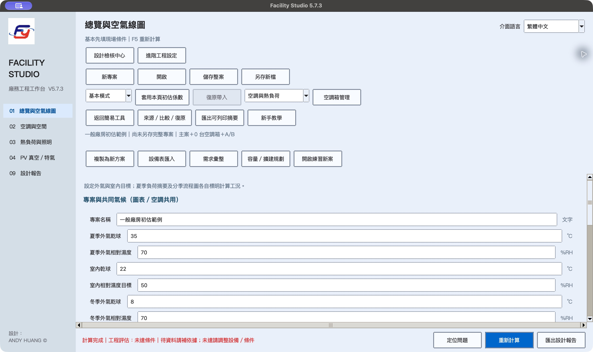
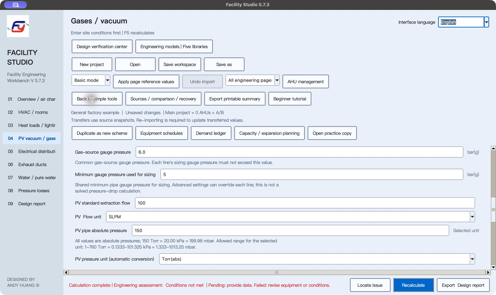

# Facility Studio visual tour

[繁體中文](visual-tour.md) · [Home](../README.en.md) · [Getting started](getting-started.en.md) · [Tool index](guides/README.en.md)

These three diagrams were prepared on 2026-11-08 against the 5.7.3 documentation and source commit `01e0a3239e1dc962e76d8c23a91a2f623eaebe95`. They illustrate workflows and model boundaries, not actual UI screens. They do not establish acceptance of another candidate, native package or FEED deliverable. Check the [matching Release](https://github.com/azx4121/facility-studio/releases) for actual platform publication and evidence.

## 1. Choose a workspace for your question

- **One calculation:** choose electrical, ducts, gases/PV, water, lighting, air states or units.
- **An entire room/project:** use the full workbench for climate, rooms, loads, airflow paths and project reports.
- **Equipment and expansion:** compare seasonal staged-AHU demands and screen current, expansion and N−1 capacity cases.
- **Document preparation:** use design review to record sources, adopted conditions and missing evidence; professional review remains necessary.

The workspaces have separate saving scopes. Saving a full workbench project does not save an independent capacity plan or design review. See [saving](faq.en.md#saving).

## 2. Complete your first report

Start with the [first synthetic practice project](guides/workbench.en.md#first-case). Read missing-data and failed-condition warnings after calculating. Do not invent inputs just to clear a warning. Explicitly reimport changed upstream values into downstream tools and review their adopted assumptions again.

Project JSON is for reopening work; TXT/HTML/PDF is for reading. Full calculation-result JSON and direct-lighting result JSON are not reopenable full-project files. Follow the [six-step workbench guide](guides/workbench.en.md#start).

## 3. An AHU target point is not proof of available capacity

This is a staged-AHU treatment concept, not a mandatory configuration or a complete FFU/DCC return-air network. Each stage receives the preceding outlet. Bypass unused stages. Check seasonal flow bases, heat/moisture balances, installed capacities and vendor data at the same operating conditions.

Surplus H2 capacity cannot directly offset insufficient H1 capacity. Colder chilled water or a BF/ADP airflow search does not guarantee feasibility. See the [AHU guide](guides/ahu.en.md).

## 4. Actual interface: 5.7.3 v22 r3 on macOS ARM64

These are native application-window screenshots of the **5.7.3 / build 5.7.3.2, v22 r3 UNVALIDATED-COMPILE-ONLY candidate** running on macOS 27.3 ARM64. The electrical and overview screens use the **Traditional Chinese interface**; the PV screen was switched to **English through the UI**. They use built-in samples and test inputs. The original 2880 × 1716 JPEGs are uncropped and unretouched, with their actual version titles. They are not relabeled mac.8 images.

### Electrical tool

This candidate retains input power, operating current and design current. **Automatic wiring selection is suspended.** Conductors, breakers, ampacity, voltage drop and PE require separate engineering verification. The displayed estimates are not a formal selection.

### Full engineering workbench

The original sample inputs and “conditions not met” engineering state remain visible. Opening the workbench does not validate the sample or all calculations.

### English PV vacuum screen

This is an actual language change through the UI, not a translated overlay. The 100 SLPM value is a test input. Longer English sidebar labels are clipped at this native window size and remain unchanged in the image. Native inspection also found clipped bottom-button text in the default-height AHU manager; resizing has not yet been reviewed.

Partial checks covered native launch, About 5.7.3, selected tool navigation, opening the workbench and English report page, one PV case, English TXT export, cancelling/reopening export, saving workspace JSON and loading the built-in MAU/AHU practice case. These are not full functional, numerical, English-layout, complete export or formal FEED acceptance. Workspace reopening and detailed individual-AHU checks remain incomplete. The candidate source inventory has a digest but no verified Git commit mapping; main's CI cannot substitute for acceptance of this package, platform parity or public publication.

[Exact artifact identity, save times and original SHA256](images/README.md#v573-v22-r3). The [historical mac.8 / win.10 originals and provenance](images/README.md#historical-screenshots) retain their original identities and are no longer used as the current display.

[Image and diagram provenance](images/README.md) · [Acceptance evidence schema](verification/5.7.3-release-acceptance.md)

**DESIGNED BY ANDY HUANG ©**
