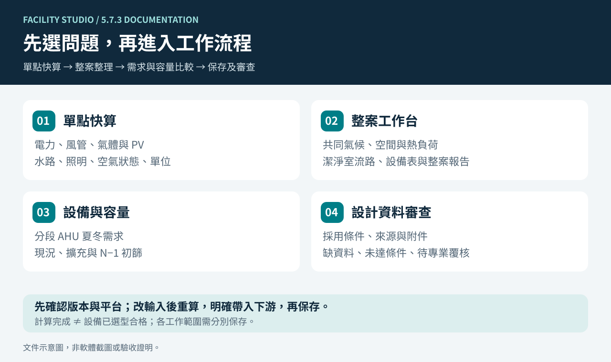
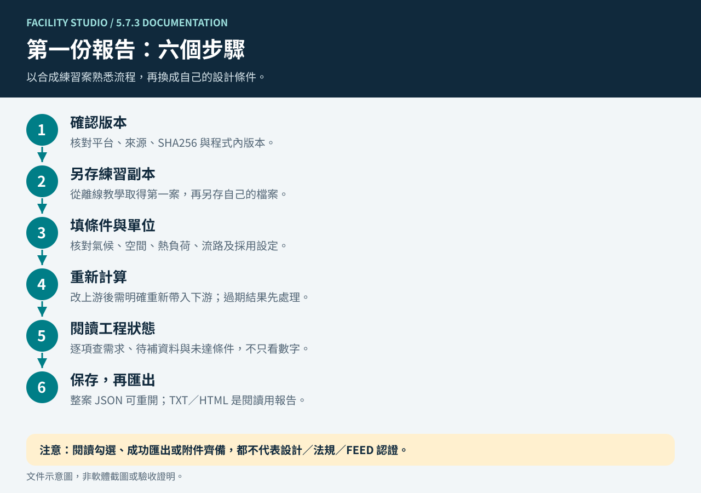
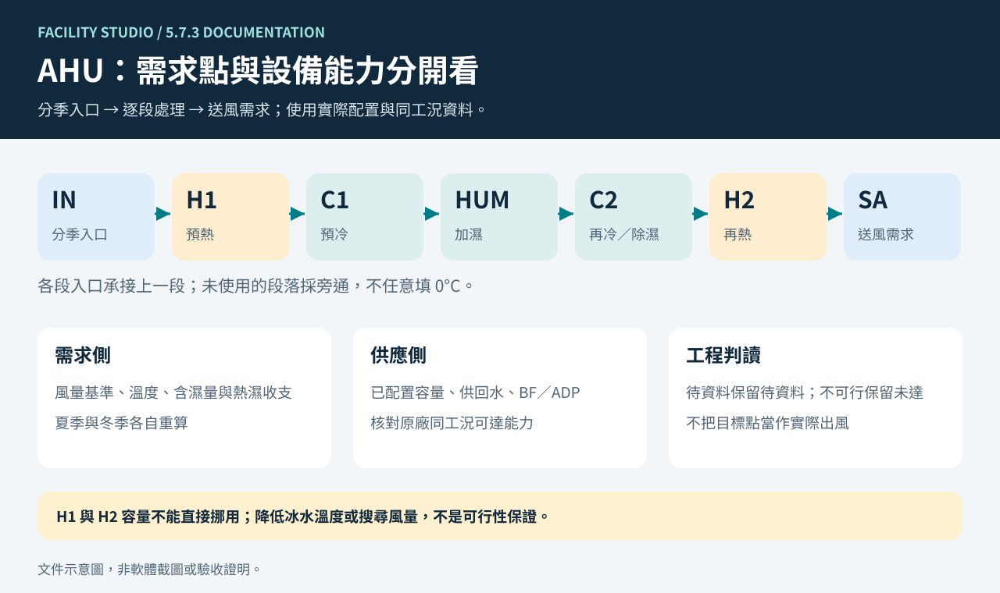
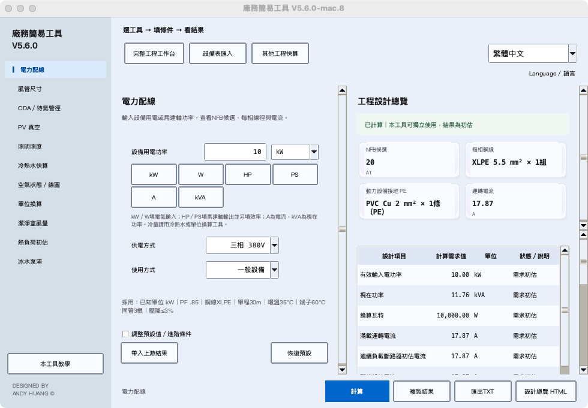

# Facility Studio 圖解導覽

[English](visual-tour.en.md) · [首頁](../README.md) · [安裝與起步](getting-started.md) · [工具索引](guides/README.md)

以下三張圖解對照 5.7.3 文件與來源提交 `01e0a3239e1dc962e76d8c23a91a2f623eaebe95`，於 2026-11-08 編製。它們是操作與模型示意，不是實際介面截圖，不代表 其他候選包、原生成品或 FEED 已完成驗收。原生平台與公開下載狀態仍以[對應 Release](https://github.com/azx4121/facility-studio/releases)為準。

## 1. 依問題選入口

- **只解一個問題：**選電力、風管、氣體／PV、水路、照明、空氣狀態或單位等直接工具。
- **整理整個空間：**使用完整工作台整理氣候、空間、熱負荷、流路與整案報告。
- **比較設備與擴充：**在分段 AHU 檢查夏冬需求；在容量計畫比較現況、擴充與 N−1 初篩。
- **整理交付依據：**設計審查記錄來源、採用條件與缺件，仍需專業覆核。

各工作範圍的保存動作不同，完整工作台的「儲存整案」不會代替獨立容量計畫或設計審查的保存。看[資料保存](faq.md#saving)。

## 2. 第一份報告怎麼完成

先從[第一個合成練習案](guides/workbench.md#first-case)開始。重算後讀「待補資料」和「未達條件」，不要為了消除警告填入未確認數字。改上游後明確重新帶入下游，並再次核對採用條件。

整案 JSON 用於重開繼續工作；TXT／HTML／PDF 用於閱讀。完整驗算資料 JSON、直接照度結果 JSON 不等同可重開的整案。逐步操作見[工作台六步教學](guides/workbench.md#start)。

## 3. AHU 圖上的目標，不等於設備已能達到

這是分段空調箱的處理順序概念，不是每個專案都必須採用的配置，也不是完整 FFU／DCC 回風管網。每段入口承接上一段；實際未使用段落應選旁通。夏冬各自核對風量基準、熱濕收支、已配置容量及原廠同工況資料。

H1 容量不足不能拿 H2 餘量直接抵銷。較低冰水溫度或 BF／ADP 風量搜尋也不保證可行。詳細見[分段 AHU 指南](guides/ahu.md)。

## 4. 想看真實介面：歷史原生截圖

以下是 **V5.6.0 mac.8** 的實際原生畫面，保留原圖與版本標題，只供了解舊版介面，不是 5.7.3 截圖。來源為 [GitHub Actions 41278438651](https://github.com/azx4121/facility-studio/actions/runs/41278438651)；主機、擷取方式與 SHA256 見[圖片來源紀錄](images/README.md)。

[Windows win.10 原圖](images/v560-win10-native-zh.png)亦保留歷史身分。這些舊圖不可用於證明現行成品已發布、各平台一致或新功能已通過。

[圖片與圖解來源](images/README.md) · [驗收證據格式](verification/5.7.3-release-acceptance.md)

**DESIGNED BY ANDY HUANG ©**
